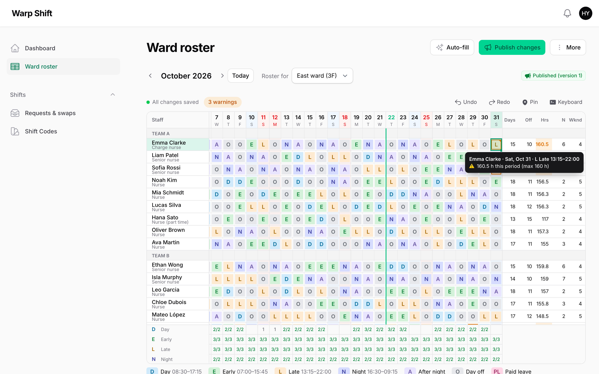

# Warp Shift



**Monthly shift rosters for Filament. Type shift codes like a spreadsheet, see staff shortages and rule breaks as you type, collect day-off requests, auto-fill a draft, publish it, and let staff swap shifts and ask for cover. The roster is drawn on a `<canvas>`, so a whole ward or shop stays fast to type in.**

<a href="https://demo.warpui.com/shift"></a>

Type a month of shifts with the keyboard, auto-fill the rest, publish, then sign in as a nurse to ask for cover and see it approved at **[demo.warpui.com/shift](https://demo.warpui.com/shift)**. No sign-up needed; the data is reset every hour.

Most people who plan shifts end up in a spreadsheet: it is the fastest way to type a month. What a spreadsheet cannot tell you is that Tuesday is one nurse short, that someone works six days in a row, or that a night shift has nobody senior on it. Warp Shift keeps the spreadsheet speed and adds those answers, live, plus the parts around the roster: requests from staff, publishing, swaps and the calendar on their phone.

```php
use App\Models\Nurse;
use Illuminate\Database\Eloquent\Builder;
use Qalainau\FilamentWarpShift\Pages\ShiftRoster;
use Qalainau\FilamentWarpShift\Roster;
use Qalainau\FilamentWarpShift\Rules\AfterShift;
use Qalainau\FilamentWarpShift\Rules\MaxConsecutiveDays;
use Qalainau\FilamentWarpShift\Rules\MinDaysOff;
use Qalainau\FilamentWarpShift\Rules\RequiredSkill;

class WardRoster extends ShiftRoster
{
    public static function roster(Roster $roster): Roster
    {
        return $roster
            ->staff(Nurse::class)
            ->staffQuery(fn (Builder $query, string $ward) => $query->where('ward_id', $ward))
            ->scopes(fn () => Ward::query()->pluck('name', 'id')->all())
            ->groupStaffBy('team')
            ->skills(fn (Nurse $nurse) => $nurse->is_senior ? ['leader'] : [])
            ->rules([
                MaxConsecutiveDays::make(5),
                AfterShift::make('N')->then(['A', 'O']),
                MinDaysOff::make(9),
                RequiredSkill::make('leader')->on(['N'])->atLeast(1),
            ]);
    }
}
```

## Contents

- [Why](#why) · [Features](#features) · [Requirements](#requirements) · [Installation](#installation)
- Setting up: [The roster page](#the-roster-page) · [Staff](#staff) · [Shift codes](#shift-codes) · [Rosters per ward or shop](#rosters-per-ward-or-shop) · [Periods](#periods) · [Holidays](#holidays)
- Planning: [Typing in the roster](#typing-in-the-roster) · [Times in a cell](#times-in-a-cell) · [Two times in a day](#two-times-in-a-day) · [The day by hour](#the-day-by-hour) · [Notes](#notes) · [Places](#places) · [Staff needed](#staff-needed) ([from your app](#staff-needed-from-your-app)) · [Rules](#rules) ([keys that no code has](#keys-that-no-code-has), [who works together](#who-works-together)) · [Rotations](#rotations) · [Auto-fill](#auto-fill) · [Why this person?](#why-this-person) · [Fairness over the year](#fairness-over-the-year) · [Help from another ward](#help-from-another-roster) · [Labour cost and budget](#labour-cost-and-budget) · [Importing from Excel](#importing-from-excel) · [Publishing](#publishing) · [Closing a roster](#closing-a-roster)
- Staff: [My shifts](#my-shifts) · [Requests](#requests) · [Leave balance](#leave-balance) · [Availability](#availability) · [Reminders](#reminders) · [Swaps and cover](#swaps-and-cover) · [Open shifts](#open-shifts) · [Approving swaps and requests](#approving-swaps-and-requests) · [Calendar feed](#calendar-feed) · [Notifications](#notifications)
- [Clock-ins (actuals)](#clock-ins-actuals) · [Excel, CSV and printing](#excel-csv-and-printing) · [Payroll summary](#payroll-summary) · [Using rosters from your code](#using-rosters-from-your-code) ([rules and projections](#rules-and-projections-from-your-code)) · [Saving and working together](#saving-and-working-together) · [Permissions](#permissions) · [Tenancy](#tenancy) · [Testing](#testing) ([browser tests](#browser-tests-javascript)) · [Keyboard](#keyboard) · [Limitations](#limitations) · [Troubleshooting](#troubleshooting)

## Why

- **As fast as a spreadsheet.** Select a cell and press `E`. Type a night shift and the "after night" and the day off are filled in for you. Copy and paste with Excel, drag the corner to repeat a pattern, undo anything.
- **You see the problems while you type.** Each day shows how many people each shift has and needs. Cells that break a rule get a red or amber corner, and the tooltip says why ("6 days in a row (max 5)").
- **Auto-fill gives you a draft you can use.** It keeps what you pinned and every day-off request, never breaks a rule you marked as an error, spreads nights and weekends evenly over the whole year, tops people up to their contract hours, stays within the budget, and tells you what it could not fill. Make three drafts and pick one, and ask "why this person?" about any cell.
- **Shops and wards alike.** Type `10-15` for an hourly shift (or `10-14,17-21` for a split shift), set staff needed per time of day, and drag shifts on a timeline of the day. Borrow someone from another ward or shop for a short day.
- **Sites without a code per site.** Security, cleaning and staffing firms put a site on each shift ("Day at Tower A") and set the staff needed per site, instead of making one code for every site and time.
- **Plan and clock-ins side by side.** See "plan 9-18, clocked 9:12-19:30" in one cell, with late, early, overtime, no-shows and work on a day off in colour, and who is not in yet today. Your attendance table stays the only place for clock-ins (or import a time clock's CSV).
- **Part-timers' availability, once.** "Tuesdays and Thursdays only", "weekdays until 3 pm": staff register it once in My shifts (or your app passes it), the roster shades the days they cannot work, and auto-fill plans around it every month.
- **The whole loop is inside your app.** Staff send requests, see the published roster on their phone, subscribe to it in their calendar, swap shifts, ask for cover and pick up open shifts that nobody could fill. Managers approve with one click and see beforehand whether a change breaks a rule.
- **No per-person pricing.** A license covers a project, not a head count.

## Features

- Monthly roster on a `<canvas>`: frozen names, days and totals; weekends and holidays shaded; groups (teams) as header rows; phone layout
- Typing by code or label (works with IME, so `早` or `夜` work too), a code list with Enter or double-click, Delete, copy and paste (TSV, to and from Excel), fill handle with repeating patterns, undo and redo, pinned cells
- Notes on a shift ("Training in room 3"), shown to the person in My shifts and their calendar
- Saved by itself a moment after you type; per-cell conflict detection when two people edit the same roster
- Staff needed per shift for every day, weekdays, holidays or a single date (minimum and maximum), per time of day ("3 people from 11:00 to 14:00") and per place, or from your app (a closure turns bookings or orders into each day's numbers)
- Times typed into a cell (`10-15`, `9:30-14`) for hourly shifts and split shifts (`10-14,17-21`), with breaks by your own rule; a timeline of the day with drag to move and resize shifts, and a chart of how many people work at each time
- Places (sites, posts, counters) on a shift, read from your own model; auto-fill puts people at the places that need them
- Rules: consecutive days, shift sequences, rest hours between shifts, hours per period, counts per shift, days off, people with a skill on a shift, overtime limits of a Japanese 36 agreement, and requests; each as an error or a warning, each for everyone or some staff, with values per person
- Whole-team rules: the average night hours of the ward (Japan's 72-hour rule for nurses) and total hours
- Who works together: keep newcomers (or two people who clash) off the same shift, and put a preceptor on every newcomer's shift
- Rotations ("4 on, 2 off", "Day → Night → After night → Off") poured into the rows you pick, per person from your data, carried on into the next period, and put in first by auto-fill
- Leave balance from your app: leave past the balance is marked, refused in requests and kept by auto-fill; a warning for people who take too little leave over the year
- Japanese public holidays built in
- PHP API to read published shifts (for clock-in or payroll), a payroll summary per person, rule breaks and projected hours and overtime per person, and the rule breaks of each day and of the whole team (`RosterEvaluation`), and to make and publish rosters (for seeders and imports)
- **Browser tests**: a small JavaScript API for Playwright: where a cell is on the canvas, what each cell shows, and when the roster has finished saving
- Clock-ins next to the plan: passed from your attendance table (or imported from a time clock's CSV), with late, early, overtime, no clock-in, missing clock-out and work without a shift marked in the roster, today's late and missing people above it, clock-in bars in the day view, and payroll from the hours worked
- Auto-fill (only empty cells, or everything except pinned cells), fairness for nights and weekends counted over the whole year, top-up shift, a report of what is short, and three drafts to compare (balanced, requests first, fairness first, lowest cost)
- "Why this person?" for any shift: the reasons, and why each colleague is not on it
- Help from another ward or shop on short days, with the people who are spare or free there first
- Labour cost per day and per period from hourly wages, allowances and night premiums, with a budget
- Import a roster from Excel or CSV (names in a column, days in a row), checked before it goes in and undone with Ctrl/⌘ + Z
- Requests from staff (day off, a shift, not a shift) with a deadline, an "I'm done" button, and reminders before the deadline
- Availability: the days and hours each person can work every week ("Tuesdays and Thursdays only", "weekdays until 15:00"), registered by staff in My shifts or passed from your own data; marked in the roster before you type, kept by auto-fill and help from another roster
- Publishing with versions; only the people whose shifts changed are notified
- Swaps between two people and cover requests open to everyone free that day; a night moves together with its rest day
- Open shifts: post what auto-fill could not fill; only staff who are free and break no rule see them and raise a hand; you pick one (or the first one gets it) and the roster and the published version are updated
- My shifts for staff (month calendar, phone friendly), an iCalendar feed (days off and leave too, if you like), database and mail notifications
- Excel and CSV download, a printable A3 view
- 10 languages, dark mode, Filament tenancy

## Requirements

- PHP 8.3+
- Laravel 12 or 13
- Filament 5.x (Livewire 4)
- MySQL 8 / MariaDB 10.6+, PostgreSQL 14+ or SQLite

## Installation

> **Warp Shift is a commercial plugin.** A license is required. After purchase you receive credentials for the private Composer repository.

Add the repository and authenticate:

```bash
composer config repositories.qalainau composer https://qalainau.privato.pub/composer
composer config --auth http-basic.qalainau.privato.pub "your-email" "your-license-key"
```

Install the package, run the migrations and publish Filament's assets:

```bash
composer require qalainau/filament-warp-shift
php artisan migrate
php artisan filament:assets
```

The migration creates `warp_shift_codes`, `warp_shift_plans`, `warp_shift_assignments`, `warp_shift_requirements`, `warp_shift_requests`, `warp_shift_swaps`, `warp_shift_open_shifts`, `warp_shift_open_shift_claims`, `warp_shift_availabilities`, `warp_shift_actuals`, `warp_shift_submissions` and `warp_shift_publications`. Your tables are not changed. To edit the migration, publish it with `php artisan vendor:publish --tag=filament-warp-shift-migrations`. Publish it before you run `php artisan migrate` for the first time: Warp Shift then runs your copy instead of its own. If the tables already exist, change them with a migration of your own instead.

Register the plugin in your panel and add your roster page:

```php
use App\Filament\Pages\WardRoster;
use Qalainau\FilamentWarpShift\FilamentWarpShiftPlugin;

return $panel
    ->databaseNotifications()
    ->pages([WardRoster::class])
    ->plugin(FilamentWarpShiftPlugin::make());
```

> Run `php artisan filament:assets` again after every update of the package.

### Navigation group

The plugin's pages (Shift codes, My shifts, Requests & swaps) go in a navigation group called "Shifts" (translated). Put them in your own group with `navigationGroup()`:

```php
FilamentWarpShiftPlugin::make()
    ->navigationGroup(fn () => __('Shifts & attendance'))
```

Pass a **closure** when the label is translated. The panel is configured before the app knows the signed-in user's language (before your middleware calls `App::setLocale()`), so `->navigationGroup(__('Shifts & attendance'))` would be translated once, in the app's default language, and the plugin's pages would end up in a different group from your own resources for users who read another language. The closure is called each time the navigation is built, in the user's language. A plain string still works when you use one language. `null` (or a closure that returns `null`) keeps the default "Shifts".

### AI coding assistants (Laravel Boost)

Warp Shift ships instructions for AI coding assistants such as Claude Code, Cursor and Codex. If your app uses
[Laravel Boost](https://laravel.com/docs/boost), the assistant learns how to use Warp Shift from them: which classes
to extend, which rules are built in, what is easy to get wrong, and how to test a roster.

- **Guidelines** (`resources/boost/guidelines/core.md`): a short summary that Boost adds to `CLAUDE.md`,
  `AGENTS.md` and the other agent files. It also points the assistant to this README in `vendor/`, so it reads the
  documentation of the version you have installed instead of guessing.
- **Skill** `warp-shift-development` (`resources/boost/skills/`): the steps for adding a roster, choosing the rules,
  and writing feature and browser tests. The assistant loads it when it works on a roster.

Boost does not add guidelines of other vendors' packages on its own. When `php artisan boost:install` asks
"Which third-party AI guidelines/skills would you like to install?", select `qalainau/filament-warp-shift`. To do
it without the question, add the package to `boost.json` and run the command again:

```json
{
    "packages": ["qalainau/filament-warp-shift"]
}
```

```bash
php artisan boost:install --guidelines --skills -n
```

## The roster page

A roster page is a class that extends `ShiftRoster` and returns its settings from the static `roster()` method. Put it in `app/Filament/Pages` (or add it with `->pages()`), like any Filament page. You can have several roster pages, for example one for nurses and one for doctors; each keeps its own rosters.

`roster()` is static on purpose: Warp Shift also calls it outside the page (to approve a swap, to build the calendar feed), so it must not read the page's properties. What changes between rosters of the same page (the ward, the shop) is the [scope](#rosters-per-ward-or-shop), which the closures receive.

The page title is "Roster". Set `protected static ?string $title` on your page to change it, and `$navigationIcon`, `$navigationGroup` and `$navigationSort` as on any page.

## Staff

The rows of the roster are your own models: `User`, `Employee`, `Nurse`… Add the `HasShifts` trait to the model:

```php
use Qalainau\FilamentWarpShift\Concerns\HasShifts;

class Nurse extends Model
{
    use HasShifts;
    use Notifiable; // to receive "your shifts are out" and swap notifications
}
```

| Method | What it does |
| --- | --- |
| `staff(Nurse::class)` | The model of the rows. Required. |
| `staffQuery(fn (Builder $query, string $scope) => …)` | Which staff are on the roster, and in which order. Without an `orderBy`, rows are ordered by key. |
| `groupStaffBy('team')` | Header rows that group the staff. An attribute, a dotted relation (`'team.name'`) or a closure returning a string. Rows are grouped where the value changes, so order the query by it too. |
| `staffLabel(fn (Nurse $nurse) => …)` | The name in the row. Defaults to `getShiftStaffName()` from `HasShifts`, which returns `name`. |
| `staffDescription(fn (Nurse $nurse) => …)` | A small second line under the name (the role, "part time"…). |
| `skills(fn (Nurse $nurse) => ['leader'])` | Skills used by `RequiredSkill`. Any strings. |
| `staffTenantRelationship('hospitals')` | With [tenancy](#tenancy): the relationship from the staff model to the tenant. Found by itself when it is named like the tenant (`team()` or `teams()`). `false` if you limit the staff to the tenant in `staffQuery()` yourself. |

When someone leaves the staff query (moves to another ward, leaves the company), their row disappears from the roster but their shifts stay in the database and come back if they return.

## Shift codes

Shift codes are managed under **Shifts → Shift codes** (the resource is added by the plugin; hide it with `->codes(false)`).

| Field | Meaning |
| --- | --- |
| Code | What you type and see in a cell, 1–4 characters: `E`, `N`, `早`, `PL`. |
| Name | Shown in the code list, the legend and tooltips: "Early", "Night". |
| Key | Used in your PHP code: in rules (`AfterShift::make('N')`), requirements and exports. Unique per tenant. Keep it stable. |
| Counts as | **Work** counts as a working day and its hours; **Day off** and **Leave** count as days off; **Rest** (for "after night") counts as neither. |
| Starts / Ends / Break | Working time. An end earlier than the start means the next day (night shifts). Hours are end − start − break. Codes without times count as 0 hours. |
| Order | The order in the code list, the legend and the staff needed rows. You can also drag the rows. |
| In use | Turned off codes can no longer be typed, but stay in old rosters. |

The code and the key can differ. Rules, `codes([...])`, requirements, rotations and `RosterPlan` always take the **key**: a night shift typed as `N` whose key is `night` (for example a key that comes from your payroll system) is written like this:

```php
ShiftCode::query()->create(['key' => 'night', 'label' => 'N', 'name' => 'Night', 'kind' => CodeKind::Work, 'starts_at' => '23:00', 'ends_at' => '07:30', 'break_minutes' => 30]);
ShiftCode::query()->create(['key' => 'after_night', 'label' => 'A', 'name' => 'After night', 'kind' => CodeKind::Rest]);
ShiftCode::query()->create(['key' => 'off', 'label' => 'O', 'name' => 'Day off', 'kind' => CodeKind::Off]);

->rules([
    AfterShift::make('night')->then(['after_night', 'off']),   // not AfterShift::make('N')
    RequiredSkill::make('senior')->on(['night'])->atLeast(1),
])
```

A rule, `codes()` or a rotation that names a key no code has is [checked when the roster is read](#keys-that-no-code-has). The other examples in this README use codes whose key and code are the same (`N`).

A code can also carry your own data in its `meta` column (a JSON object, not shown in the form), for example the site or the contract a shift is for. Warp Shift does not use it; [reading published shifts](#reading-published-shifts) returns it with every shift:

```php
ShiftCode::query()->create(['key' => 'site_a_day', 'label' => 'A日', 'name' => 'Site A, day', 'kind' => CodeKind::Work, 'starts_at' => '08:00', 'ends_at' => '17:00', 'break_minutes' => 60, 'meta' => ['site_id' => 12]]);
```

A code that a roster uses cannot be deleted (that would break old rosters); turn it off instead.

All rosters of a tenant share the codes. When rosters need different codes (a hospital and a café in the same app), give each roster the keys it uses; the others are not offered, not typed and not used by auto-fill:

```php
->codes(['OP', 'MD', 'CL', 'O'])
```

Typing matches the code first, then the key, without regard to case. When one code matches exactly and no other code starts with what you typed, it is filled in at once; otherwise the code list opens filtered to what you typed.

## Rosters per ward or shop

```php
->scopes(fn () => Ward::query()->orderBy('name')->pluck('name', 'id')->all())
->staffQuery(fn (Builder $query, string $ward) => $query->where('ward_id', $ward))
```

`scopes()` returns `[key => label]`. The page shows a "Roster for" select, and each scope has its own rosters, staff needed, requests and publications. The current scope is in the URL (`?scope=3`). Without `scopes()` there is one roster per period and the scope is an empty string.

## Periods

By default a roster covers a calendar month. For 4-week rosters:

```php
->cycle(days: 28, anchor: '2026-01-05')
```

Periods then start on the anchor and every 28 days before and after it. The page shows the period's dates instead of the month name. The current period is in the URL (`?from=2026-11-01`).

Rules that look back (consecutive days, sequences, rest hours) continue from the end of the previous period: the last 7 days of the previous roster are read along (`->lookback(7)` to change). Auto-fill also places the "after night" and the day off that follow a night at the end of the previous roster.

## Holidays

```php
->holidays(fn (CarbonImmutable $from, CarbonImmutable $to) => Holiday::query()->whereBetween('date', [$from, $to])->pluck('date')->all())
```

Return dates as `Y-m-d` strings or date objects. Holidays are shaded like Sundays, can have their own [staff needed](#staff-needed), and count as weekend days for fairness and the "Wknd" total.

### Japanese public holidays

Japanese holidays are built in, with substitute holidays (振替休日) and the days between two holidays (国民の休日):

```php
use Qalainau\FilamentWarpShift\Support\JapaneseHolidays;

->holidays(fn (CarbonImmutable $from, CarbonImmutable $to) => JapaneseHolidays::between($from, $to))

// Add your own closing days
->holidays(fn (CarbonImmutable $from, CarbonImmutable $to) => [
    ...JapaneseHolidays::between($from, $to),
    ...$company->closedDays()->whereBetween('date', [$from, $to])->pluck('date')->all(),
])
```

The list is the Cabinet Office's official one (国民の祝日, from 1955), shipped with the plugin. Years the Cabinet Office has not published yet are worked out from the current holiday law (Happy Monday days, the equinox formula, substitute holidays), which gives the same days as the official list for every year since 2022. One-off holidays (such as an enthronement) appear once a plugin update includes the new list.

| Method | Returns |
| --- | --- |
| `JapaneseHolidays::between($from, $to)` | The dates (`Y-m-d`, both ends included, in order). |
| `JapaneseHolidays::named($from, $to)` | `['2026-11-03' => '文化の日', ...]`. Substitute holidays and days between holidays are named `休日`. |
| `JapaneseHolidays::name($date)` / `isHoliday($date)` | The name of one day (or `null`) / whether it is a holiday. |

## Typing in the roster

Click a cell and type a code. With one cell selected the cursor then moves to the next day, so you can type a person's week as `E E L L N` without touching the mouse. Select a range (drag, or Shift + click, or click a name or a date) and type a code to fill all of it.

- **Enter**, **F2** or a double-click opens the code list. Arrow keys and Enter pick; "Clear" empties the cells.
- **Delete** or **Backspace** clears the selected cells.
- **Copy and paste** use tab-separated text, so they work with Excel and Google Sheets in both directions. A single value pasted into a range fills the range. Unknown codes are skipped and listed.
- **Fill handle**: drag the square at the bottom-right of the selection. The selected pattern repeats: select `E E L L N A O` and drag to the right to repeat a rotation.
- **Pin** (Ctrl/⌘ + K, the Pin button or the right-click menu): auto-fill never changes a pinned cell, and typing skips it. A pin shows as a small dot in the corner.
- **Undo / Redo**: Ctrl/⌘ + Z and Ctrl/⌘ + Y (or Shift + Z), also after auto-fill and paste.

When you type a code that starts a sequence rule (`AfterShift::make('N')->then(['A', 'O'])`), the following empty, unpinned days are filled with the sequence too, and the cursor jumps past them.

## Times in a cell

For shops, cafés and anywhere people work different hours every day, type the times instead of a code: `10-15`, `9:30-14`, `1000-1500`, `22-6`. Full-width digits and `〜` work too. The code list shows **Use these times**; Enter puts them in. The cell then shows `10-15` in the code's color.

- On a cell that already has a work shift, the shift stays and only its times change. On an empty cell (or a day off), the cell gets the roster's time code:

  ```php
  ->timeCode('MD')   // default: the first work code of the roster
  ```

- The break comes from your own rule, given the minutes from start to end. Without it, the code's break is used:

  ```php
  // Japan's Labour Standards Act: 45 minutes over 6 hours, 1 hour over 8 hours
  ->breaks(fn (int $minutes) => $minutes > 480 ? 60 : ($minutes > 360 ? 45 : 0))
  ```

- An end earlier than the start is the next day, as with codes. Typed times count everywhere times count: hours, rest between shifts, overtime, [time-of-day staff needed](#staff-needed-by-time-of-day), [labour cost](#labour-cost-and-budget), My shifts, the calendar feed, the API and the exports.
- Typing another code over the cell, or a day off, removes the times. Undo brings them back.
- Copy gives `10-15`, and pasting `10-15` from Excel works the same way as typing it.

## Two times in a day

For split shifts (a café that needs people for lunch and dinner, a cleaner who comes in the morning and the evening), type both times with a comma: `10-14,17-21`. `、` and `/` work as the comma too. The code list shows **Use these two times**; the cell shows `10-14` above `17-21`.

The shift is still **one shift code** for the day, with two times. That is on purpose: every rule, swap, request and auto-fill works with one shift per person per day, and two separate shifts on one day would change all of them for little gain. If two parts of the day are different jobs, give them different [places](#places) on different days, or use one code for the combination.

How the two times count:

| What | Counts |
| --- | --- |
| Hours, overtime ([`MaxOvertime`](#overtime-japans-36-agreement)), [`MaxHours`](#rules), [payroll](#payroll-summary) | Both times added up; the gap between them is not work. |
| Break | From [`breaks()`](#times-in-a-cell), given the length of both times together (`10-14,17-21` is 480 minutes, not 660). The gap is not a break. |
| Rest between shifts (`MinRestHours`) | From the end of the second time to the next day's start, and from the day before to the start of the first. |
| [Staff needed by time of day](#staff-needed-by-time-of-day), the chart of [the day by hour](#the-day-by-hour) | Each time on its own: the person is not counted at 15:00. |
| Night premium, [night hours](#whole-team-rules), [labour cost](#labour-cost-and-budget) | The parts of both times that fall in the band. |
| My shifts, the [calendar feed](#calendar-feed) | Both times; the feed has two events that day. |
| [The API](#reading-published-shifts) | `startsAt` is the start of the first time and `endsAt` the end of the second; `parts()` gives both, `minutes()` leaves the gap out. |

The second time starts after the first one ends and both fit in 24 hours from the first start; `10-14,13-18` and `10-14,14-18` are refused. The second time may end after midnight (`18-22,23-2`). In the day by hour, a split shift has two bars; drag either one, but not over the other. Excel and CSV show `10-14,17-21`, and [importing](#importing-from-excel) reads it back.

## The day by hour

Right-click a cell and choose **See the day by hour**, or click a [time-of-day staff needed](#staff-needed-by-time-of-day) row, to open a timeline of that day above the roster:

- one row per person, with their shift as a bar; drag a bar's ends to change the start or the end, and its middle to move it (15 minutes at a time). The new times go into the cell as [typed times](#times-in-a-cell), saved and undone like typing;
- drag across an empty row to add a shift with those times;
- the chart at the top shows how many people work at each time, with a dashed line for the staff needed and red where it is short;
- nights that started the day before, and days the person spends in another ward, are shown but cannot be dragged. Pinned cells cannot be dragged either.

Use ‹ and › to go to the day before or after, and × to close it.

Marks in a cell:

| Mark | Meaning |
| --- | --- |
| Red or amber corner and border | Breaks a rule (red: error, amber: warning). Hover for the reason. |
| Small circle, top left | A request: filled when approved, a ring while waiting, crossed for "not this shift". |
| Small dot, bottom right | Pinned. |
| Gray line at the bottom | Not saved yet. |
| Small colored dot, bottom left | Different from the published version. |
| Small triangle, top left | Has a [note](#notes). Hover to read it. |
| Thin colored stripe on the left, small letters under the code | Has a [place](#places) (the place's color and short label). |

The bar above the roster shows whether everything is saved and how many rule breaks there are. Click the count for a list; click a line to go to the cell.

## Notes

Right-click a cell and choose **Note…** (or press **Shift + F2**) to leave a note on that shift: "Training in room 3 at 14:00", "Hand over the keys", "Help on the West ward after lunch". Enter saves, Shift + Enter starts a new line, Escape closes without saving; **Remove note** deletes it. Notes are up to 255 characters.

- The person sees the note with that day in **My shifts** (a "Note" tag in the calendar, a dot on phones, and the text when they open the day), and in their [calendar feed](#calendar-feed) as the event's description. Like shifts, they see it once you publish; a changed note counts as a change, so publishing tells that person.
- A note belongs to the shift in the cell: changing the shift code keeps it, clearing the cell removes it. Undo brings both back.
- Copy, paste, the fill handle and auto-fill copy shift codes only; a note stays on its cell as long as the cell has a shift.
- An approved swap or cover moves the notes with the shifts.
- Excel, CSV and the print view list the notes after the table (in print, cells with a note get a `*`).
- An empty cell cannot have a note; type a shift first.

## Places

Security guards, cleaners, temps and field staff work the same shifts at different sites. Instead of a code per site and time ("Tower A, day", "Tower A, night", "Mall, day" … 20 sites × 3 times = 60 codes), keep a few shift codes and put a **place** on each shift: the cell is "Day" + "Tower A".

The places come from your own model; Warp Shift has no table of its own for them. The cell stores the key you give (your model's id):

```php
public static function roster(Roster $roster): Roster
{
    return $roster
        ->staff(Guard::class)
        ->codes(['D', 'N', 'O'])
        ->places(fn (string $scope) => WorkSite::query()
            ->where('branch_id', $scope)      // the ward or shop of the roster ('' without scopes())
            ->orderBy('name')
            ->get()
            ->mapWithKeys(fn (WorkSite $site) => [$site->id => [
                'name' => $site->name,        // in the tooltip, My shifts, the calendar feed, the API
                'label' => $site->short_name, // 2–3 letters, under the code in the cell (default: the first 2 letters of the name)
                'color' => $site->color,      // the stripe in the cell (default: a color from a fixed set)
            ]])
            ->all());
}
```

`[$id => $name]` works too (`WorkSite::query()->pluck('name', 'id')->all()`). The callback runs once per request and scope.

**Putting a place on a shift.** Select one or more cells, right-click and choose **Place…** (or press **Shift + F3**), and pick a place; type a few letters to narrow the list. **No place** takes it off. Only working shifts have a place; days off are skipped. The place is part of the cell like a [note](#notes): saved with the cell, undone with Ctrl/⌘ + Z, kept when you change the shift to another working shift (Day → Night at the same site), removed by a day off or clearing the cell. Copy, paste and the fill handle copy the place too: copying gives `D@TA` (code, `@`, the place's label), and pasting `D@TA` or `D@Tower A` from Excel works the same way.

**Staff needed per place.** In **More → Staff needed**, pick a place in a row: "Day at Tower A: 2", "Night at Tower A: 1", "Day at Harbor Mall: 2 on weekends". Each gets its own row under the roster, right under the code's row, with the place's color (`D · Tower A 1/2`), and clicking a number sets that day only, as for any shift. A shift at Tower A counts for "Day at Tower A" and for "Day" (without a place); a requirement without a place counts everyone on the shift. With **For a time of day**, a place counts only the people at that place in the window.

**Auto-fill** fills the place rows first and puts the place on the shifts it makes; when it swaps two people to even things out, their places go with their shifts. [Help from another roster](#help-from-another-roster) borrows into the place that is short.

**Everywhere else:**

- Publishing keeps the places; a changed place counts as a change, so publishing tells that person. My shifts shows the place under the shift (`TA`) and its name when the person opens the day. The [calendar feed](#calendar-feed) puts it in the event's location.
- Approved [swaps and cover](#swaps-and-cover) move the place with the shift.
- Excel and CSV show `D@TA` in the cell and list the places (label and name) after the table; the print view shows the label under the code.
- [`PublishedShift`](#reading-published-shifts) has `$place` (your key) and `$placeName`, so payroll or billing can price a shift by site and shift code. [`RosterPlan`](#making-and-publishing-rosters) takes `'place' => $site->id`.
- A place that is no longer in `places()` stays on old shifts and shows its key.
- Rosters that do not call `places()` work exactly as before: no menu item, no rows, nothing in the cells.

## Staff needed

Open **More → Staff needed** to set, per shift, how many people are needed: at least, optionally at most, and on which weekdays and holidays. For example "Early: at least 3 every day", "Day: at least 2, at most 5, Monday to Friday".

Each shift with a requirement gets a row under the roster showing `staffed/needed` per day, red when short and amber when over the maximum. Click a number to set that day only (a ward that needs an extra nurse on the day of an inspection); "Use the usual number" goes back to the weekday setting.

When several settings fit a day, the most specific wins: a single date, then holidays, then weekdays, then every day.

### Staff needed by time of day

Turn on **For a time of day** in a row to say how many people are needed from one time to another: "3 people from 11:00 to 14:00 on weekdays". Leave the shift empty to count everyone who works then, whatever their shift, or pick a shift to count only it.

The window is cut into 30-minute slots, and the number shown is the **fewest** people working at any moment of the window: one person 10:00–15:00 and one 12:00–18:00 make 1 for 11:00–14:00, because at 11:00 only one is there. Breaks are not taken out (people take them in turn). A night that started the day before counts for the morning.

```php
->slotMinutes(15)   // count every 15 minutes (default 30)
```

Each window gets a row under the roster (`10-14 Anyone working`); click it to open [the day by hour](#the-day-by-hour). Auto-fill fills a window with the shift codes that cover most of its missing time; it does not invent times of its own.

From code, a time-of-day requirement is a `Requirement` with `starts_at`, `ends_at` and an optional `code_id`:

```php
Requirement::query()->create(['roster' => CafeRoster::class, 'scope' => 'harbor', 'code_id' => null, 'starts_at' => '11:00', 'ends_at' => '14:00', 'weekdays' => [1, 2, 3, 4, 5], 'min' => 3]);
```

### Staff needed from your app

When the number comes from your own data (bookings, orders, beds, deliveries), return it per day instead of typing it:

```php
->requirements(fn (CarbonImmutable $date, string $scope) => [
    'D' => (int) ceil(Booking::forDay($date, $scope)->count() / 30),   // 1 per 30 bookings
    'L' => [2, 4],                                                       // at least 2, at most 4
    'D#tower-a' => 3,                                                    // per place: "code#place key"
    '@11:00-14:00' => Booking::lunch($date, $scope)->count() > 60 ? 4 : 3, // a time of day, any shift
    'L@17:00-21:00' => ['min' => 2, 'max' => 3],                           // a time of day for one shift
])
```

The closure is called for each day of the period with the [scope](#rosters-per-ward-or-shop) of the roster (`''` without scopes), so load the period once in your app if it is heavy. Keys are a shift code, `code#place` for a [place](#places), or `code@HH:MM-HH:MM` / `@HH:MM-HH:MM` for a [time of day](#staff-needed-by-time-of-day); values are the minimum or `[min, max]` (`['min' => .., 'max' => ..]` works too). Return `[]` or leave a key out to use what is set in **Staff needed** for that day.

An app number is stronger than anything set on the roster for the same day and row (even a single-date number). Its cells get a small dot in the row under the roster, the tooltip says it comes from your app, and clicking it does not open the editor. Codes or places that are not on the roster, and times not written as `HH:MM`, are ignored. Auto-fill, the export, printing and [`RosterEvaluation`](#rules-and-projections-from-your-code) use these numbers like any other.

## Rules

```php
->rules([
    MaxConsecutiveDays::make(5),
    AfterShift::make('N')->then(['A', 'O']),
    MinRestHours::make(11)->warn(),
    MaxHours::make(fn (Nurse $nurse) => $nurse->contract_hours)->warn(),
    MaxCount::make('N', 8),
    MinCount::make(['E', 'L'], 4)->warn(),
    MinDaysOff::make(9),
    RequiredSkill::make('leader')->on(['N'])->atLeast(1),
])
```

| Rule | Breaks when |
| --- | --- |
| `MaxConsecutiveDays::make(5)` | Someone works more than 5 days in a row, counting from the end of the previous period. `->codes(['N'])` counts only those shifts (consecutive nights). Marks every day past the limit. |
| `AfterShift::make('N')->then(['A', 'O'])` | The days after `N` are not `A` and then `O`. Empty days are not marked (they get filled as you type). |
| `MinRestHours::make(11)` | Less than 11 hours between the end of one day's shift and the start of the next day's, using the codes' times. |
| `MaxHours::make(160)` / `MinHours::make(120)` | More / fewer hours in the period. The maximum marks the day it is crossed; the minimum marks the person's row once the row is complete. |
| `MaxCount::make('N', 8)` / `MinCount::make('N', 2)` | More / fewer of those shifts in the period. Pass an array of keys to count several. |
| `MinDaysOff::make(9)` | Fewer days off (Day off and Leave codes) in the period, once the row is complete. Auto-fill plans this many days off. |
| `RequiredSkill::make('leader')->on(['N'])->atLeast(1)` | On a day where someone works `N`, fewer than 1 of them has the skill. Marks the date. |
| `Availability::make()` | Someone works on a day or at a time they [cannot work](#availability). Added for you as an error when you use `availability()`; list it yourself to make it `->warn()` or `->only(...)`. |
| `MaxOvertime::make(45)` | Overtime (over 8 hours a day and 40 hours a week) goes over the limits of a Japanese 36 agreement. See [Overtime](#overtime-japans-36-agreement). |
| `NotTogether::skill('new')->on(['N'])` | More than one person of the group works the same shift on the same day. See [Who works together](#who-works-together). |
| `Together::skill('new')->withSkill('preceptor')->on(['N'])` | Someone of the group works a shift with no partner on the same shift that day. See [Who works together](#who-works-together). |
| `LeaveBalance::make()` | Someone has more leave days than their [leave balance](#leave-balance). Added for you as an error when you use `leaveBalance()`. |
| `MinLeaveDays::make(5)->year(4)` | Someone has taken less leave since the start of the year than they should have by now. A warning by default. See [Leave balance](#leave-balance). |

Every rule:

- is an **error** by default: red, and auto-fill never breaks it. `->warn()` makes it a **warning**: amber, and auto-fill avoids it when it can.
- takes a number or a **closure per person** (`fn (Nurse $nurse) => $nurse->contract_hours`); people for whom the closure returns `null` are not checked.
- can be limited to some people with `->only(fn (Nurse $nurse) => ! $nurse->is_part_time)`.

Requests are checked too: a cell that breaks a day-off or "not this shift" request gets a warning.

### Keys that no code has

Rules name shift codes by their **key** (see [Shift codes](#shift-codes)). A key that no code has would make the rule check nothing, so Warp Shift checks the keys of the rules, `codes([...])` and `rotations()` each time a roster is read (the roster page, `RosterEvaluation`, auto-fill), against the codes of the current tenant, turned off codes included:

| The key | Outside production | In production |
| --- | --- | --- |
| is the **code** (label) of another code: `AfterShift::make('N')` where `N` is typed for the code with the key `night` | an `InvalidArgumentException` that names the key, the rules that use it and the key it should be (`'N' is the label of 'night'`) | a warning in the log |
| matches no code at all (a typo, or a code this tenant has not created yet) | a warning in the log | a warning in the log |

Nothing is checked while there are no shift codes yet. The warning is written once per request. To decide yourself:

```php
->strictCodes()        // every unknown key throws, in production too (your app creates all the codes)
->strictCodes(false)   // only log, also for labels
```

In an app where each tenant creates its own codes on the Shift codes screen, keep the default: a tenant who has not added, say, a paid-leave code still gets their roster, and the log tells you which rule is idle.

### Who works together

Two rules look at the people on the same shift on the same day (the same code; with `->samePlace()`, the same [place](#places) too).

```php
use Qalainau\FilamentWarpShift\Rules\NotTogether;
use Qalainau\FilamentWarpShift\Rules\Together;

->rules([
    // Newcomers: at most one on each night
    NotTogether::skill('new')->on(['N']),
    // Two people who should not share any shift
    NotTogether::make([$ann->id, $bob->id])->warn(),
    // A newcomer's night needs a preceptor on it too
    Together::skill('new')->withSkill('preceptor')->on(['N']),
    // Mia works only with Kim or Lee, at the same site
    Together::make([$mia])->withStaff([$kim, $lee])->samePlace(),
])
```

| Method | |
| --- | --- |
| `NotTogether::make($staff = null)` / `Together::make($staff = null)` | The group, by key or model. Without it, everyone (narrowed by `skill()` and `only()`). |
| `NotTogether::skill('new')` / `Together::skill('new')` | The group is the people with this [skill](#staff). Combine with `->only(fn (Nurse $nurse) => ...)`. |
| `->on(['N'])` | The shifts to look at. Default: every work shift. Each shift code is counted on its own. |
| `NotTogether::...->atMost(2)` | How many of the group may share a shift (default 1). |
| `Together::...->withSkill('preceptor')` / `->withStaff([...])` | Who counts as a partner: people with the skill, the people listed (keys, models or `fn (Nurse $nurse) => bool`), or both. The person themselves never counts. Without either, anyone else on the shift counts. |
| `Together::...->atLeast(2)` | How many partners are needed (default 1). |
| `->samePlace()` | Count only people at the same place. |

A break of `NotTogether` marks the cell of every person of the group on that shift; a break of `Together` marks the person without a partner. Auto-fill never breaks them when they are errors and avoids them when they are warnings, and **Why this person?** says "Working Night with Mia" and "Partner for Ann on Night". Only the cells of this roster count; a preceptor helping another ward is not a partner here.

### Whole-team rules

Some limits are about the whole ward, not one person. They mark the **Staff** heading of the roster (hover it for the reason) and appear in the list of rule breaks as "Whole team". Auto-fill keeps to them like to any other rule.

| Rule | Breaks when |
| --- | --- |
| `AverageNightHours::make(72)` | The average night hours of the people who work nights are over 72 in the period. Japan's rule for hospital wards (月平均夜勤時間 72 時間以下). |
| `TeamMaxHours::make(2400)` | Everyone's hours together are over 2,400 in the period. `->codes(['OT'])` adds up only those shifts. |

```php
use Qalainau\FilamentWarpShift\Rules\AverageNightHours;

AverageNightHours::make(72)
    ->between('16:00', '08:00')         // the night band your hospital set (16 hours including 22:00–5:00)
    ->countingFrom(16)                  // people with fewer night hours than this are left out, from the hours and from the count
    ->codeHours(['N' => 13.5])          // optional: night hours of one shift, if your counting differs from the times
    ->only(fn (Nurse $nurse) => $nurse->role !== 'assistant')
    ->warn();
```

Night hours are the part of a shift (its code's times, or the [typed times](#times-in-a-cell)) inside the night band. The break is taken out in proportion: a 16:30–9:00 night with a 2-hour break and a 16:00–8:00 band has 930 of its 990 minutes in the band, so 930 − 120 × 930 / 990 = 817 minutes count. If your hospital counts breaks differently, give the hours per shift with `codeHours()`. With the rule, each person gets a **Night** total. Only the cells of this roster count; a nurse who [helps another ward](#help-from-another-roster) counts there for that day.

Rules are checked in the browser as you type and on the server for auto-fill and swap approvals, with the same results. Rules only mark problems; they never stop you from saving or publishing, because sometimes a roster has to break one.

### Overtime (Japan's 36 agreement)

`MaxOvertime` counts overtime as you type and marks the day a limit of the 36 agreement (36協定) is crossed. With the rule, the roster also gets an **OT** total per person (and a **Hol.** total for holiday work when you set `legalHoliday()`).

```php
use Qalainau\FilamentWarpShift\Rules\MaxOvertime;

MaxOvertime::make(45)                         // 45 hours a month (the default)
    ->yearly(360, startsIn: 4)                // 360 hours a year, the agreement year starting in April (the default)
    ->weekStartsOn(0)                         // the week starts on Sunday (0) … Saturday (6); the default is Sunday
    ->legalHoliday(0)                         // optional: work on Sundays is holiday work (休日労働), counted apart from overtime
    ->specialClause()                         // optional: the special clause (特別条項)
    ->priorOvertime(fn (Employee $employee, CarbonImmutable $from, CarbonImmutable $to) => $employee->overtimeHoursByMonth($from, $to))
    ->only(fn (Employee $employee) => ! $employee->is_manager) // leave out managers (管理監督者)
    ->warn();
```

**How overtime is counted.** A shift's working time is its end minus its start minus its break. Overtime is the time over 8 hours on a day, plus, adding up each day's first 8 hours from the start of the week, the time over 40 hours in the week. A shift that crosses midnight counts on the day it starts. Without `legalHoliday()`, work on a statutory day off is not told apart (it counts as overtime, so the warning comes earlier rather than later). The week before the period is read along (`->lookback()`, 7 days by default; keep it at 6 or more), so a week that starts in the previous month is counted whole. `->legalHours(daily: 8, weekly: 40)` changes the legal hours.

**Holiday work (休日労働).** `legalHoliday()` tells work on the statutory day off (法定休日) apart from overtime, as the law counts it:

- `->legalHoliday(0)`: the statutory day off is a weekday, Sunday (0) … Saturday (6), or a closure that returns one. Every shift on that weekday is holiday work.
- `->legalHoliday()` (or a closure that returns `null`): no fixed weekday. When a week (cut by `weekStartsOn()`) has no day off, its last day is holiday work. A day without a work code counts as a day off (off, leave, an empty cell, or the rest day after a night, since the night counts on the day it starts).

A whole shift on that day is holiday work. It is left out of the 8 hours a day and the 40 hours a week, and out of the monthly and yearly limits and the count of months over 45 hours; it is added to overtime for under 100 hours a month and the 2–6 month average. Variable days off (4 days off in 4 weeks, 変形休日制) are not supported.

**What it checks.** The month is the roster's period.

| Setting | Breaks when |
| --- | --- |
| `make(45)` (`null` to skip) | The period's overtime is over 45 hours. |
| `yearly(360, startsIn: 4)` (`null` to skip) | The earlier months of the agreement year plus this period are over 360 hours. |
| Always (the law's own limits) | Overtime plus holiday work reaches 100 hours in the period (it must stay **under** 100), or its average over this period and the 1–5 months before it is over 80 hours. |
| `specialClause(monthly: 100, average: 80, yearly: 720, times: 6)` | Instead of `make()` and `yearly()`: the year is over 720 hours, or this is the 7th month over 45 hours in the agreement year. `monthly` and `average` change the two limits above. |

Each problem marks the day it is crossed, and the tooltip says which limit and what it counts ("時間外 46 時間（上限 45 時間）", "時間外と休日労働 101 時間（100 時間未満まで）"). The person's OT total turns red or amber too. As an error, auto-fill does not give anyone a shift that would cross a limit.

**Earlier months.** The year, the average and the count of months over 45 hours need the overtime of earlier months. Pass `priorOvertime()` a closure that returns `['Y-m' => hours]` for one person, or `['Y-m' => ['overtime' => hours, 'holiday' => hours]]` to give holiday work too (it then counts only toward the average). It gets the person and the range it needs: from the start of the agreement year or five months back, whichever is earlier, to the day before the period. Return what actually happened (from your attendance records), not the old rosters. Months that are missing count as 0 hours. Without `priorOvertime()` only this period is counted.

The limits and the week can differ per company: `roster()` is built for each request, so pass the current company's settings (`->weekStartsOn($company->week_starts_on)`), or a closure for the week.

## Rotations

Factory shifts and security posts often follow a fixed pattern: "4 on, 2 off", "Day → Night → After night → Off", "Early, Early, Late, Late, Off, Off". Give the patterns names, and optionally say who follows which:

```php
public static function roster(Roster $roster): Roster
{
    return $roster
        ->rotations([
            'four-two' => ['label' => '4 on, 2 off', 'codes' => ['D', 'D', 'D', 'D', 'O', 'O']],
            'rotating' => ['D', 'N', 'A', 'O'],               // the label is then "D N A O"
        ])
        ->staffRotation(fn (Guard $guard) => $guard->rotation === null ? null : [
            'rotation' => $guard->rotation,                   // a key of rotations(), or a list of codes
            'from' => $guard->rotation_starts_on,             // the day the pattern's first code falls on (optional)
        ]);
}
```

**Apply a rotation** (More, or right-click the rows) fills the rows you pick:

| Field | |
| --- | --- |
| People | Preselected from the rows you right-clicked. |
| Rotation | One of `rotations()`, **Each person's own rotation** (`staffRotation()`), or **Type the codes** (`D D N N O O`, or labels such as `日日夜夜休休`). |
| First day starts with | **Carry on from the days before** (default), or a step of the pattern. |
| From / Until | Any days of the period (default: all of it). |
| Only empty cells | Keep what is already typed. |
| Pin the cells it fills | So auto-fill leaves them alone. |

Where the pattern starts:

1. a step you pick wins;
2. otherwise, with `'from'` in `staffRotation()`, the step is counted from that day, so every period carries on by itself;
3. otherwise the plugin looks at the cells just before the first day (the end of the previous period, up to `lookback()` days) and carries on from the step they match best ("D D D D O" before the 1st → the 1st is the second O);
4. if nothing matches, the pattern starts at its first code.

Pinned cells, day-off requests, days a person [cannot work](#availability) (for work codes) and days they help another roster are left as they are, and the dialog says how many. The cells go in like typed ones: they are saved by themselves and one Ctrl/⌘ + Z takes them all out.

With `staffRotation()`, the auto-fill dialog has **Put in rotations first** (on by default): those people get their rotation before the rest is filled (cells that would break an error rule, such as a day they cannot work, are left for the usual filling; with [places](#places), a work shift goes to a place that is still short), and the others cover what is still needed.

## Auto-fill

**Auto-fill** opens a dialog with two choices:

- **Only empty cells** keeps everything already typed.
- **Everything except pinned cells** starts over.

It then:

1. keeps pinned cells and places a day off on every day-off request (approved or waiting; a request for a leave code gets that code while the [leave balance](#leave-balance) allows), and the rest days after the previous period's last nights;
   with **Put in rotations first**, it then places each person's [rotation](#rotations);
2. goes day by day and fills each shift up to the staff needed, choosing people for whom it breaks no error rule (including their [availability](#availability): nobody on a day they cannot work, and "from 17:00" gets a late shift), preferring people who asked for that shift, people with a missing skill, people with fewer of that shift and fewer working days so far, and avoiding people it would push over a warning (contract hours);
3. gives everyone the days off of `MinDaysOff`, spread over the period, and fills the remaining days with `->fillWith('D')` (up to their hours) or a day off;
4. improves the result for a few seconds by trading cells between two people on the same day (or the few days of a night sequence), to remove rule breaks and even out the fairness counts;
5. saves, and reports how many cells changed, which days are still short and how many rule breaks are left.

```php
->offCode('O')              // the day off code it uses (default: the first Day off code that is not right after a sequence)
->fillWith('D')             // the shift for remaining days (default: none, they become days off)
->fairness(['N', 'weekend']) // what to spread evenly: shift keys and 'weekend' (Saturdays, Sundays and holidays)
->autoSchedule(false)       // hide the button
```

Auto-fill is a heuristic, not a solver: with tight rules it can leave a day short, and it says so. It is undone with one Ctrl/⌘ + Z. It does not use a queue; a month for 30 people takes a few seconds.

When some short days could be filled by [borrowing from another ward](#help-from-another-roster), the report says how many.

### Comparing drafts

Turn on **Make 3 drafts and compare** in the dialog. Auto-fill then makes the roster three ways and shows them side by side:

| Draft | Leans towards |
| --- | --- |
| Balanced | The usual auto-fill. |
| Requests first | Keeping requests (days off, wanted and unwanted shifts), even if the nights are less even. |
| Fairness first | Evening out the shifts and weekends of `fairness()`, even if fewer requests are kept. |
| Lowest labour cost | Cheaper people first and as little cost as the staff needed allows. Only when [wages](#labour-cost-and-budget) are set. |

Each draft lists its rule breaks, warnings, people short, the share of requests kept, how far apart the most and the fewest of each fairness count are, and the labour cost. Pick one and it goes into the roster like a normal auto-fill (pinned cells stay, Ctrl/⌘ + Z undoes it). The drafts are kept for 30 minutes in your cache. Making them takes a few seconds longer than one auto-fill.

## Why this person?

Right-click a working shift and choose **Why this person?**. A panel lists:

- why this person is on it: pinned, asked for it, has the skill the shift needs, how many of that shift they have this period against the team average (and this year against their fair share, with [fairness over the year](#fairness-over-the-year)), weekends, hours against their limit;
- for everyone else that day: why they are not on it (asked for a day off, already on another shift, resting after a night, on leave, helping another ward), which rule it would break for them, or that they could take it and how many of that shift they have so far.

It is worked out in the browser from the roster as it is now, unsaved changes included, so it explains shifts you typed yourself as well as auto-filled ones.

## Fairness over the year

`fairness()` evens out shifts within the period. To even them out over the year, so that a person who had many nights last month gets fewer this month:

```php
->fairness(['N', 'weekend'])
->fairnessYear(4)           // the year starts in April (default 1, January)
```

For each person and each fairness key, Warp Shift counts the earlier periods of the year, on every roster of the same page (all wards), and compares it with a fair share: the team's average per period × the number of periods the person was on a roster. Someone who joined in October is not asked to catch up on April to September.

- **Fairness** in the bar above the roster opens a table: per person and per key, this period's count, the year's count (`yr`), and the difference from the fair share (`+2` = two more than their share).
- Auto-fill adds each person's difference to their counts, so the people behind get more.

## Help from another roster

On a short day, borrow someone from another ward or shop for the day. The roster must have [scopes](#rosters-per-ward-or-shop):

```php
->scopes(fn () => ['east' => 'East ward', 'west' => 'West ward'])
->borrowing()
```

**More → Help from another roster** asks for a short day, the shift (filled in from the shortage) and who. It offers people from the other scopes in this order:

1. people whose ward has more of a shift than it needs that day (they move, and their own ward still has enough);
2. people with nothing planned that day in their own ward;
3. people with a day off there (not a requested one, and not pinned).

People who would break an error rule are not offered: their own rules count the days in both wards. Borrowing moves the day: their cell in their own ward is cleared, and they get the shift in yours.

- In your roster they appear under **Help from other rosters**, with their own ward under their name, only for the days they help. Clear the cell to send them back.
- In their own ward the day shows striped with the shift they work elsewhere, and cannot be typed over. Nobody can be on two rosters of the same page on the same day; a save that tries is refused like a conflict.
- Auto-fill leaves borrowed people as they are and gives them nothing else.
- Publishing the roster that borrows shows the day in their My shifts ("Helping East ward") and their calendar feed. Swaps and cover are not offered for borrowed days.

## Labour cost and budget

```php
->hourlyWage(fn (Nurse $nurse) => $nurse->hourly_wage)   // or a number for everyone
->allowances(['N' => 5000])                              // a fixed amount per shift
->nightPremium(0.25, '22:00', '05:00')                   // wage × 0.25 for the time in this band (Japan's 深夜割増)
->currency('JPY')                                        // ISO 4217; without it, plain numbers
->budget(fn (Plan $plan) => $plan->scope === 'east' ? 4_000_000 : 3_000_000)
```

With `hourlyWage()`, the roster shows the cost of each day in a row under the roster, and the period's total in the bar above (`Labour cost ¥3,820,000 / budget ¥4,000,000`, red when over). A shift costs wage × hours (without the break) + its allowance + the night premium for the part inside the band (the break taken out in proportion, as for [night hours](#whole-team-rules)).

The budget is per period. `budget()` gives the default; **More → Budget** sets one for the period, and an empty value goes back to the default. Over the budget is a warning for the whole team (`->budget(…, strict: true)` makes it an error). Auto-fill never adds [`fillWith()`](#auto-fill) shifts past the budget; staff needed are still filled. Only the cells of this roster count (a borrowed nurse costs in the ward they help).

## Importing from Excel

**More → Import from Excel** reads an `.xlsx` or CSV file of a roster made elsewhere:

- one row has the days: day numbers (`1`, `2`, `3(Mon)`, `5日`), dates (`2026-11-05`, `11/5`, Excel dates);
- one column, left of the days, has the names, matched to the roster's names without regard to case, spaces or full-width letters;
- cells have codes, labels or names of shift codes, or [times](#times-in-a-cell) (`10-15`, `10-14,17-21`). With [places](#places), `D@TA` or `D@Tower A` puts the place too (a cell without `@` gets no place). Empty cells are skipped.

Before anything changes, a dialog shows what was found: how many people and days, how many cells will be filled, names that are not on the roster and codes that were not found. Choose **Only empty cells** or **Replace what's there**; pinned cells and days in another ward are never changed. **Import** puts the cells in like typing, so they are saved by themselves and one Ctrl/⌘ + Z takes the whole import back.

The file is read in the browser and never uploaded. `.xls` (Excel 97–2003) files cannot be read; save them as `.xlsx` or CSV.

## Publishing

Staff see the **published** version, never the draft you are typing in. **Publish** makes the first version; afterwards the button reads **Publish changes**, and the dialog tells you how many people's shifts changed. Only they are notified, with the days that changed. Publishing when nothing changed does nothing.

Cells that differ from the published version get a small colored dot, so you can see what you have changed since.

## Closing a roster

**More → Close this roster** makes it read-only for everyone: no typing, auto-fill, requests or swaps. Use it at the end of the month, before payroll. **Reopen this roster** undoes it.

## My shifts

The plugin adds **My shifts** for staff: a month calendar of their published shifts with times, their requests and pending swaps. Tap a day to send a request, ask for a swap or ask for cover. It works on phones.

Staff are matched to the signed-in user with `staffForUser()`:

```php
FilamentWarpShiftPlugin::make()
    ->staffForUser(fn (User $user) => $user->nurse)   // default: the user is the staff (staff model is User)
```

When the staff model is not `User`, `staffForUser()` is required: without it the `User` is taken as the staff record, so My shifts opens with an empty calendar (no error) and staff never see their published shifts. Users without a staff record (the closure returns `null`) do not see the page. Hide it with `->myShifts(false)`, or decide per tenant and per person:

```php
FilamentWarpShiftPlugin::make()
    ->myShifts(fn (Employee $staff, ?Company $company) => $company?->uses_shifts ?? false)
```

```php
// A panel without Filament tenancy, where tenantKey() names the company
FilamentWarpShiftPlugin::make()
    ->tenantKey(fn () => CurrentCompany::get())
    ->myShifts(fn (Employee $staff, ?Company $company) => $company?->uses_shifts ?? false)
```

The closure gets the staff record of the signed-in user and the current company: the Filament [tenant](#tenancy), or, in a panel without tenancy, what [`tenantKey()`](#another-tenant-key-tenantkey) returns (a model, or your key if it returns a key; `null` when neither is set). When it returns `false`, My shifts is left out of the navigation and opening its URL gives 403, like Filament's `canAccess()`. In a panel shared by companies that plan shifts and companies that do not, staff of the second kind then see no empty "My shifts".

## Requests

Open **More → Collect requests**, turn it on and optionally set the last day. Staff can then ask, per day, for a **day off**, to **work a shift** (or any shift) or **not to work a shift**, with a note. They can change or remove a request until the last day (the whole day counts).

Requests appear in the roster as small circles with the note in the tooltip, and auto-fill keeps every day-off request. Managers can approve or decline them in **Requests & swaps**; a declined request disappears from the roster and the person is notified.

In My shifts, staff with nothing to ask for tap **I'm done with my requests**, so you know they have looked. The Collect requests dialog shows how many people have sent requests or said they are done.

Turn requests off entirely with `->requests(false)`.

## Leave balance

Pass how many leave days each person has left, and the roster keeps leave codes within it:

```php
->leaveBalance(fn (Employee $staff, CarbonImmutable $periodStart) => $staff->leaveDaysLeft($periodStart))
// or count only some leave codes:
->leaveBalance(fn (Employee $staff, CarbonImmutable $periodStart) => $staff->paid_leave_left, codes: ['PL'])
```

Return the days left **at the start of the period**, before this period's leave cells (half days such as `7.5` are fine; `null` means "do not check this person"). Leave codes are the codes of kind **Leave** (or the `codes` you pass); each cell counts as one day.

- **Roster.** The leave day past the balance gets a red corner ("Leave day number 3, but only 2 left"). This is the `LeaveBalance` rule, added for you as an error; list `LeaveBalance::make()->warn()` in `rules()` for a warning.
- **Requests.** In [My shifts](#my-shifts), a day-off request can name a leave code ("Kind of leave"). The dialog shows how many leave days the person can still ask for this period (the balance minus leave cells and leave requests), and a request past it is refused.
- **Auto-fill** puts a leave request in as that leave code while the balance allows, and as a plain day off after that. It never adds leave past the balance.

### Leave over the year

Some countries require a minimum amount of leave to be taken each year. `MinLeaveDays` warns about people who are behind:

```php
use Qalainau\FilamentWarpShift\Rules\MinLeaveDays;

->rules([
    MinLeaveDays::make(5)->year(4)                                   // 5 days a year, the year starts in April
        ->codes(['PL'])                                              // optional: which leave codes count
        ->only(fn (Employee $staff) => $staff->annual_leave_days >= 10)
        ->takenBefore(fn (Employee $staff, CarbonImmutable $from, CarbonImmutable $to) => $staff->leaveTaken($from, $to)),
])
```

By the end of each period, a person should have taken `days × (days of the year so far ÷ days of the year)`, rounded down: 5 days a year from April means 3 by the end of November and all 5 by the end of March. Leave in this period counts as soon as the row is complete. Days before the period come from `takenBefore()`, or, without it, from the leave cells of this roster page (every ward or shop) since the start of the year. The warning marks the person's row ("2 days of leave so far this year (should be 3 by now, 5 a year)"). Make it an error with `->warn(false)`.

#### A leave year per person

When the leave year starts on a different day for each person (for example, the day their leave was granted, which depends on when they joined), give each person their own start with `yearFrom()`:

```php
use Carbon\CarbonImmutable;
use Qalainau\FilamentWarpShift\Rules\MinLeaveDays;

->rules([
    MinLeaveDays::make(5)
        ->yearFrom(fn (Employee $staff, CarbonImmutable $periodStart): ?CarbonImmutable => $staff->leaveYearStart($periodStart)),
])
```

The closure gets the person and the first day of the roster's period, and returns the first day of the leave year that this period falls in (a `DateTimeInterface` or a `'Y-m-d'` string), or `null` when the rule does not apply to that person. The year runs for one year from that day: from 1 April to 31 March, from 15 November to 14 November. A year that starts on 29 February ends on 28 February of the next year; one that starts on 31 January ends on 30 January.

- `yearFrom()` replaces `year()`: with both, `year()` is not used. People for whom the closure returns `null` get no warning, as if they were left out with `only()`. `only()` still works on top of it.
- A year that **starts during the period** (someone granted leave on the 15th of a monthly roster) only counts leave from that day, and expects the share of the year that has passed by the end of the period.
- A year that **ends during the period** is checked on its last day: leave after it does not count, and the full number of days is expected. That is the last chance to see that someone did not take enough.
- A year that starts after the period or ended before it is not checked.
- Days before the period come from `takenBefore()`, which now gets each person's own year start as `$from`; without it, from the leave cells of this roster page since that day.

**Example: a minimum after each grant of leave.** In some countries (Japan is one), people who were granted 10 or more days of paid leave must take at least 5 of them within one year of the grant. With the grants in your own table:

```php
MinLeaveDays::make(5)
    ->codes(['PL'])
    ->yearFrom(function (Employee $staff, CarbonImmutable $periodStart): ?CarbonImmutable {
        // The grant whose year is running at the start of the period; for someone new, a grant later in the period
        $grantedOn = $staff->paidLeaveGrants()
            ->where('days', '>=', 10)
            ->where('granted_on', '>', $periodStart->subYear())
            ->orderBy('granted_on')
            ->value('granted_on');

        return $grantedOn === null ? null : CarbonImmutable::parse($grantedOn);
    })
    ->takenBefore(fn (Employee $staff, CarbonImmutable $from, CarbonImmutable $to) => $staff->paidLeaveTaken($from, $to)),
```

Someone granted 10 days on 1 October 2026 should have taken 2 days by the end of March 2027 (`5 × 182 ÷ 365`, rounded down) and 5 by 30 September 2027. In the October 2027 roster, the closure returns the next grant (1 October 2027) and the count starts again. Someone who has not been granted 10 days yet gets `null` and no warning.

## Availability

Part-timers in shops and restaurants work on fixed terms every week: "Tuesdays and Thursdays only", "until 15:00 on weekdays", "never on weekends", "Mondays from 17:00". Instead of a request every month, record it once:

```php
public static function roster(Roster $roster): Roster
{
    return $roster
        ->staff(Employee::class)
        ->availability();   // staff register it in My shifts, managers change it in the roster
}
```

**In the roster**, a day someone cannot work is shaded with a short dash before anything is typed, and a day with hours shows them faintly (`17-`, `-15`). The tooltip says it in words ("On Mondays, available from 17:00"), and so does the name's tooltip for the whole week (`Mon 17:00– · Tue ×`). A working shift on such a day, or outside the hours, gets the rule's mark with the same text. Hours are checked against the shift's times: the typed times of the cell (both times of a [split shift](#two-times-in-a-day)) or the shift code's times. A shift code without times is only checked on days off. A window may cross midnight (`22:00-06:00`).

**The rule.** With `availability()`, the roster checks it as an **error**: auto-fill never puts anyone on a day or at an hour they cannot work, [help from another roster](#help-from-another-roster) does not offer them, a colleague cannot take a swap or cover on a day they cannot work, and **Requests & swaps** shows it before approving. To let managers override it, list the rule yourself as a warning; auto-fill then avoids it unless nobody else can work:

```php
->availability()
->rules([
    Availability::make()->warn(),                                   // amber instead of red
    // Availability::make()->only(fn (Employee $e) => $e->is_part_time),
])
```

"[Why this person?](#why-this-person)" says it too: "On Mondays, available from 17:00" for the person on the shift, and "Not available on Mondays" for a colleague who cannot take it.

### Registered by staff

With `->availability()` (no argument), staff open **My shifts → Availability → Change** and choose, for each weekday and for holidays, **Any time**, **Can't work** or **Only these hours** (from, until, or both). It works at phone width.

- **Starting on** makes it change from a date ("three days a week from April"). Rosters before that date keep the old times. The first registration counts from the start; a later change counts from today unless a later date is chosen.
- A change that has not started yet is listed apart ("From Tue, Apr 1") with **Edit**, and **Cancel this change** removes it. A change from today does not replace one that starts later.
- Managers right-click any cell of a person and choose **Availability…** (or **More → Availability**). The form starts from the roster's first day, so changing it while planning April leaves March as it was. The roster updates without reloading.

It is stored in `warp_shift_availabilities` (one row per change: `staff_type`, `staff_id`, `starts_on`, `days`), per tenant.

### From your own data

If your app already knows when people can work, pass a closure. Warp Shift then keeps nothing of its own, shows no form in My shifts and no Availability… in the roster; change it in your app.

```php
->availability(fn (Employee $employee) => [
    'tue' => true,
    'thu' => true,
    '*' => false,           // every other weekday: cannot work ("Tuesdays and Thursdays only")
])

->availability(fn (Employee $employee) => [
    'mon' => '17:00-',      // from 17:00
    'wed' => '-15:00',      // until 15:00
    'fri' => '10:00-15:00', // only then
    'sat' => false,         // cannot work
    'holiday' => false,     // public holidays (from holidays()), whatever the weekday
])
```

| Value | Means |
| --- | --- |
| `true` or `null`, or a day left out | any time |
| `false` | cannot work that day |
| `'17:00-'`, `'-15:00'`, `'10:00-15:00'` (also `'17-'`, `'10-15'`, `['start' => '10:00', 'end' => null]`) | only those hours |

Days are `mon` … `sun` (or `monday` …, or `0` for Sunday to `6` for Saturday, as in staff needed) and `holiday` (or `7`); `'*'` is every weekday you did not list. On a holiday, `holiday` wins when it is given, otherwise the weekday's value. Return `null` or `[]` for someone with no limits.

For terms that change on a date, return a list of periods with `from` and/or `until` (dates, inclusive); on a day that several periods cover, the one with the latest `from` wins:

```php
->availability(fn (Employee $employee) => $employee->availabilities->map(fn ($row) => [
    'from' => $row->starts_on,          // null: from the beginning
    'until' => $row->ends_on,           // null: no end
    'days' => $row->days,               // ['mon' => '17:00-', …]
])->all())
```

The closure runs once per person each time a roster is read; eager-load what it needs in `staffQuery()`. An unknown day or a time that is not a time throws an `InvalidArgumentException`, so a typo does not silently allow everything.

**Not covered:** one-off days ("not on May 3rd") are [requests](#requests); the plugin does not make one from the other. Availability is per person, not per roster: with self-registration, the same row is used by every roster page of the person that calls `availability()`.

## Reminders

Remind the people who have neither sent a request nor tapped "I'm done":

- **More → Remind about requests** lists them and sends them a notification now.
- Automatically, a few days before the last day of requests:

  ```php
  ->remindBefore([3, 1])   // 3 days before and the day before
  ```

  and run the command every day:

  ```php
  // routes/console.php
  Schedule::command('warp-shift:remind')->dailyAt('09:00');
  ```

  Each reminder day is sent once per roster, for every tenant. Rosters that are closed, not open for requests or without a last day are skipped.

The notification links to My shifts for that month.

## Swaps and cover

On a published day with a shift, staff can:

- **Swap with someone**: pick a colleague and one of their shifts. The colleague accepts or declines. They trade the whole day: if the days differ, both days are traded.
- **Ask for cover**: everyone on the same roster who is free that day sees it and can take it. The first one wins.

A night shift moves together with the rest days that follow it (`AfterShift`), so nobody is left with an "after night" without the night, and the person covering must be free on those days too.

Turn them off with `->swaps(false)`.

## Open shifts

Some days stay short: auto-fill could not find anyone, or someone called in sick after the roster went out. Instead of phoning around, post the shift. Everyone who could take it sees it in **My shifts** and taps **I can work it**; you pick one of them, and the shift goes into the roster and the published version.

Open shifts are on by default. Turn them off, or let the first person who can take it get it without your approval:

```php
->openShifts(false)              // no open shifts
->openShifts(firstCome: true)    // the first person who taps "I can work it" gets it
```

**Posting.** The roster has to be [published](#publishing) (staff only see published rosters). Then:

- **More → Post open shifts** lists every short shift from today on (from the Staff needed rows, also [per place](#places) and [per time of day](#staff-needed-by-time-of-day)), all ticked. Untick what you want to handle yourself, add a note if you like, and post. Shortages that already have an open shift say how many people are posted, so posting twice does not double them.
- After **Auto-fill**, the notification has a **Post as open shifts** button when days are still short.
- Click a number in a Staff needed row and choose **Post as an open shift** to post that shift for that day, also when the day is not short (an extra person for an event, say). Pick the shift, the place and how many people.

An open shift is one shift code on one day, for one or more people, with a [place](#places) and a note if you like. A shortage from a time-of-day row without its own shift code uses the shift that covers that time best, with the row's times typed into the cell. **Notify the people who can work it** (on by default) sends them a notification.

**Who sees it.** A person sees an open shift in My shifts (with a mark on that day of the calendar) only when they could take it:

- they are on that roster, and their published cell for that day is empty or a day off (not a shift, an "after night" or leave);
- they are not helping on another roster that day ([help from another roster](#help-from-another-roster));
- taking it breaks none of their error rules: consecutive days, rest between shifts, hours, [availability](#availability), [who works together](#who-works-together), and the others.

A night with `AfterShift` brings its rest days along: taking an open `N` also puts `A` and `O` on the next days, and the person must be free on those days too. A person who has said they can work it can take it back until it is decided.

**Choosing.** **Requests & swaps** lists the open shifts with the people who raised a hand, how many are still needed, and **Choose** next to each name. A person who can no longer take it (you changed their row since) shows the reason instead of the button. Choosing puts the shift into the roster and publishes a new version with only that change, as [approving cover](#approving-swaps-and-requests) does: the other unpublished changes in your draft stay unpublished. If you changed that person's cells in the draft after publishing, it refuses: publish the roster, then choose again. The person is notified. When all the people needed are chosen, the open shift closes and everybody else who raised a hand is told it went to someone else. **Withdraw** closes an open shift and tells the people who raised a hand. When the roster already has enough people for a posted shortage (you filled it yourself), the open shift says so; withdraw it.

With `openShifts(firstCome: true)`, the first person who taps **I can work it** gets it right away, with the same checks, and managers have nothing to approve.

Open shifts are stored in `warp_shift_open_shifts`, the raised hands in `warp_shift_open_shift_claims`; both have the [tenant columns](#columns), copied from the roster.

## Approving swaps and requests

**Requests & swaps** (for managers; hide with `->inbox(false)`) lists accepted swaps and cover with an **Approve** button, open ones still waiting for a colleague, [open shifts](#open-shifts) with the people who can work them, and waiting requests. A badge in the menu counts the swaps and raised hands waiting for you.

Before you approve, it shows the rule breaks that approving would add. Approving changes the roster and publishes a new version with only that change (other unpublished changes in your draft stay unpublished). If the roster changed in those cells since the request, it refuses: decline it and let them ask again.

```php
FilamentWarpShiftPlugin::make()
    ->managers(fn () => User::query()->where('is_manager', true)->get())  // who is told that a swap or a raised hand waits for them
```

## Calendar feed

My shifts shows a private address that staff can subscribe to in Google Calendar, Apple Calendar or Outlook. It lists their published working shifts from two months back, with their [notes](#notes) as the description and the [place](#places) as the location (a [split shift](#two-times-in-a-day) is two events), with times in the app's timezone (`config('app.timezone')`); a night ends on the next day at the clock time, also on the day clocks change. The address is signed; anyone with it can read that person's shifts, so treat it like a password.

If someone else may have the address (a shared calendar, an old phone), the person clicks **Get a new address** under it. The old address stops working at once and calendars subscribed to it stop updating, so they subscribe again with the new one. The address of a person you delete stops working too.

Days off and leave can be in the feed too, as all-day events marked as free time (so they do not block the day in a shared calendar):

```php
->calendarDaysOff()   // days off and leave in everyone's feed on this roster
```

Each person can also choose for themselves with **Show days off and leave too** under the address in My shifts; their address then carries `off=1` or `off=0`, which wins over the roster's setting. "After night" days are never in the feed. Days off are left out by default because many people share their calendar with family or colleagues, and a month of "Day off" events mostly hides the shifts; existing subscriptions keep looking the same.

## Notifications

Staff get a notification when a roster is published (the first time: everyone on it; afterwards: only people whose shifts changed), when a colleague asks them to swap, when their swap is accepted, approved or declined, when a request is declined, when an [open shift](#open-shifts) they could work is posted, and when an open shift they raised a hand for is theirs, goes to someone else or is withdrawn. Managers get one when a swap waits for approval and when someone raises a hand for an open shift.

Notifications are sent to the staff model (add Laravel's `Notifiable`) as Filament database notifications (enable `->databaseNotifications()` on the panel) and by mail when the model has an email address.

## Clock-ins (actuals)

Plans and what really happened drift apart: someone is 12 minutes late, stays an hour longer, works on a day off or never shows up. With `actuals()` the roster puts the clock-ins next to the plan, colours the differences, and the [payroll summary](#payroll-summary) and the [evaluation from your code](#rules-and-projections-from-your-code) can count the hours actually worked.

The plugin does not keep its own time clock. If your app already stores clock-ins (an attendance table), pass them in a closure. If it does not (you only get a CSV from a time clock), call `actuals()` without a closure and import the CSV in the roster; the plugin then stores them in `warp_shift_actuals`.

```php
use App\Models\AttendanceRecord;
use Illuminate\Support\Collection;

public static function roster(Roster $roster): Roster
{
    return $roster
        ->staff(Employee::class)
        // all staff in one query (batch: true); without batch the closure gets one Employee at a time
        ->actuals(fn (Collection $employees, CarbonImmutable $from, CarbonImmutable $to): array => AttendanceRecord::query()
            ->whereIn('employee_id', $employees->keys())
            ->whereBetween('work_date', [$from->toDateString(), $to->toDateString()])
            ->get()
            ->groupBy('employee_id')
            ->map(fn (Collection $records) => $records->mapWithKeys(fn (AttendanceRecord $record) => [
                $record->work_date->toDateString() => [
                    'start' => $record->clock_in_at,
                    'end' => $record->clock_out_at,      // null while still at work (or a forgotten clock-out)
                    'break' => $record->break_minutes,
                    'worked' => $record->worked_minutes, // optional: minutes you counted yourself
                    'overtime' => $record->overtime_minutes,
                    'holiday' => $record->holiday_minutes,
                    'night' => $record->night_minutes,
                ],
            ]))
            ->all(), batch: true)
        ->actualsTolerance(late: 5, early: 5, overtime: 15);
}
```

The closure returns the **work date** (`Y-m-d`, the day the shift started) → the clock-ins of that day. Each day can be:

| Shape | Meaning |
| --- | --- |
| `[$start, $end, $breakMinutes]` | One clock-in and clock-out. Times are `DateTime`s or `'09:12'`. A time earlier than the clock-in is the next morning (`'22:00', '07:00'` is a night shift). |
| `[['10:00', '14:00'], ['17:00', '21:00']]` | Several clock-ins on one day (a split shift). Time between them is not work; the break is 0 unless you pass one in the array form below. |
| `['start' => …, 'end' => …, 'break' => 60, 'worked' => 480, 'overtime' => 30, 'holiday' => 0, 'night' => 120]` | With the minutes your app already counted. When given, they are used instead of the plugin's own count for that day (`punches` instead of `start`/`end` for several clock-ins). |

`end` is `null` while the person is still at work. A night shift belongs to the day it started, like the shift on the roster. Without `break`, the break is your [`breaks()`](#times-in-a-cell) rule for the length (or 0). Days outside `$from`–`$to` are ignored.

### On the roster

**Actuals** in the bar above the roster switches the view (it is remembered on that device): each cell up to today shows the plan on top and the clock-in below, and the totals get an **Actual** column (hours on settled days; the tooltip compares them with the plan). In a narrow column the lower line shows only the time that matters — the late clock-in, the early or late clock-out — or ✓ when everything is on time; wider columns show the full `9:12-19:30`.

| Colour | What happened |
| --- | --- |
| Red | No clock-in on a scheduled day, or no clock-out (missing) |
| Yellow | Late, or left early, by more than the tolerance |
| Blue | Stayed after the end by more than the tolerance, or worked without a shift |

The tooltip says by how many minutes. `actualsTolerance()` sets how many minutes do not count (5 minutes late, 5 minutes early and 15 minutes over by default). Days after today are never judged. Today, someone who has not clocked in is marked once the start of their shift (plus the tolerance) has passed, and **Today: 1 not clocked in · 2 late** appears above the roster — click it to go to the first one. The marks on today's column show even when the view is off. The clock-ins are fetched again every minute while the roster is open.

The [day by hour](#the-day-by-hour) shows a clock-in bar under each shift (dashed while still at work).

A day only counts as settled (for the Actual column and projections) once it is over, or once today's clock-out is in. A clock-in that is still open the next morning is shown as missing, unless the shift itself has not ended yet (a night shift).

### Importing clock-ins from a CSV

With `actuals()` and no closure, **More → Import clock-in times (CSV)** reads a CSV or Excel file from a time clock in the browser (Excel's Shift_JIS and UTF-16 CSV too). One row per clock-in:

```
Staff no.,Name,Date,Clock-in,Clock-out,Break
G-001,Ray Cooper,2026/11/02,07:56,17:04,60
G-004,Ken Ito,2026/11/02,22:00,07:05,
```

- The heading row is found in the first ten rows; Japanese, English and the other eight languages work (社員番号・氏名・日付・出勤・退勤・休憩, Name, Date, Clock in, Clock out, Break…). Date, clock-in and a name or staff number are needed.
- People are matched by staff number first (`staffNumber(fn (Employee $e) => $e->code)`, the staff key without it), then by name (case, width and spaces are ignored).
- Dates: `2026-11-02`, `2026/11/02`, `11/2` or an Excel date. Times: `9:05`, `09:05:00`, `0905` or an Excel time. Break: minutes (`60`, `60分`) or `1:00`.
- Several rows for one person and day are several clock-ins on that day.

A dialog shows how many clock-ins and people it read, the days that will be saved (and how many replace clock-ins already saved), rows outside the period, names not on the roster and rows it could not read. Saving replaces the stored clock-ins of those days; **Undo import** puts the previous ones back. The stored rows have `tenant_type`, `tenant_id` first in their index like every other table.

### Payroll from clock-ins

With `actuals()`, More also has **Payroll summary from clock-ins (Excel / CSV)**, and from code `PayrollSummary::for(...)->actuals()` (see [Payroll summary](#payroll-summary)).

## Excel, CSV and printing

**More → Download Excel / Download CSV** exports the roster as you see it: one row per person, one column per day (`10-14,17-21` for a [split shift](#two-times-in-a-day), `D@TA` with a [place](#places)), the totals, and the staffed/needed rows, then the places (label and name) and the [notes](#notes) (person, date, shift, note). Excel keeps the shift colors. **More → Print** opens a print view in a new tab, laid out for A3 landscape, with the notes under the table.

## Payroll summary

**More → Payroll summary (Excel / CSV)** downloads one row per person for the period: days worked, hours, night hours (the [night premium](#labour-cost-and-budget) band, 22:00–5:00 by default), weekend days, holiday days, overtime and holiday work (with [`MaxOvertime`](#overtime-japans-36-agreement)), how many of each shift, allowances and labour cost. It covers every ward of the page, and a person who helped another ward gets one row with both. It counts the published version (with approved swaps); before the first publish it counts the draft.

From code:

```php
use Qalainau\FilamentWarpShift\PayrollSummary;

$rows = PayrollSummary::for(WardRoster::class, '2026-11-01')   // the period that contains this day
    ->tenant($hospital)                                       // outside a panel
    ->scope('east')                                           // optional: one ward
    ->draft()                                                 // optional: the draft instead of the published version
    ->actuals()                                               // optional: hours from clock-ins instead of the roster
    ->rows();

return PayrollSummary::for(WardRoster::class, now())->download('xlsx');   // or 'csv'
```

With `actuals()` (and [clock-ins](#clock-ins-actuals) on the roster) it counts what was clocked instead of the plan: only days with a clock-out, at the clocked times (work on a day off too, a scheduled day without a clock-in not at all). The minutes your app counted (`worked`, `overtime`, `holiday`, `night`) are used for those days; allowances and the count per shift only include scheduled shifts that were worked.

Each row is `['staff' => key, 'name', 'scope' => their own ward, 'days', 'hours', 'night_hours', 'weekend_days', 'holiday_days', 'overtime_hours', 'holiday_work_hours', 'codes' => ['N' => 4, …], 'allowances', 'cost']`. Hours are decimal hours rounded to 2 places; `overtime_hours` and `holiday_work_hours` are `null` without the rule, `cost` without wages.

## Using rosters from your code

Other parts of your app (clock-in, attendance, payroll, seeders, a data import) can read published shifts and make rosters without the page.

Outside a panel (a command, a job, a seeder, or a panel without tenancy), always say which tenant: `->tenant($team)`, or `WarpShift::get()->asTenant($team, fn () => ...)`. Without it, code outside a panel sees every tenant's rows. Pass the tenant model of your panel (`Team`), the key your `tenantKey()` returns, or `null` for rows without a tenant. Inside a panel with tenancy you can leave it out; the current tenant is used.

If your `staffQuery()` scopes the staff by the tenant itself (for example because the staff also appear in a panel without tenancy), use `WarpShift::get()->currentTenant()`. It returns the model passed to `tenant()` / `asTenant()`, or Filament's tenant inside a panel, so the same roster works on the page and from your code:

```php
->staffTenantRelationship(false)
->staffQuery(fn (Builder $query) => $query->where('company_id', WarpShift::get()->currentTenant()?->getKey()))
```

### Reading published shifts

```php
use Qalainau\FilamentWarpShift\PublishedShifts;

// Everyone: staff key => (Y-m-d => PublishedShift), in date order
$shifts = PublishedShifts::query()
    ->tenant($company)
    ->roster(ShiftSchedule::class)   // optional: only these roster pages
    ->scope('3')                     // optional: only this ward or shop
    ->get('2026-11-01', '2026-11-30');

// One person: Y-m-d => PublishedShift
PublishedShifts::query()->tenant($company)->forStaff($employee, $from, $to);

// One day, or null
$shift = PublishedShifts::query()->tenant($company)->on($employee, today());
```

It reads the latest published version, which is what staff see in My shifts: approved swaps and cover are in it, the draft is not. Only working shifts (codes that count as **Work**) are returned; add `->withOff()` for days off, leave and rest days too. The range can cross months. If a person is on two published rosters on the same day, the one with the later period wins.

A `PublishedShift` has:

| Property / method | Value |
| --- | --- |
| `$staffKey`, `$date` | The person's key and the day (`Y-m-d`). |
| `$startsAt`, `$endsAt` | The times on that day ([typed into the cell](#times-in-a-cell), or the code's) as dates in the app's timezone. The end is on the next day for a night shift. `null` for codes without times. For a [split shift](#two-times-in-a-day), the start of the first time and the end of the second. |
| `isSplit()`, `parts()`, `$secondStartsAt`, `secondEndsAt()` | Whether the day has [two times](#two-times-in-a-day); `parts()` is `[[start, end]]`, or two pairs for a split shift (`[]` without times). |
| `$place`, `$placeName` | The [place](#places): your key (as a string) and its name from `places()` (`null` without a place, or a name when the place is gone). |
| `key()`, `label()`, `name()`, `kind()`, `isWork()` | The code. `$code` is the `ShiftCode` model itself. |
| `breakMinutes()`, `minutes()` | The break and the working minutes (end − start − break; both times without the gap for a split shift). |
| `hasCustomTimes()` | Whether the times were typed into the cell. |
| `$note` | The cell's [note](#notes), or `null`. |
| `$meta` | The code's [`meta`](#shift-codes) (`[]` without). |
| `$planId`, `$version` | The roster and the published version it came from. |

### Rules and projections from your code

`RosterEvaluation` runs the roster's rules outside the roster page — for a dashboard ("who will go over the 36 agreement this month?"), an attendance summary or a nightly check — and returns, per person, the rule breaks and the hours. With [clock-ins](#clock-ins-actuals), settled days use what was clocked and the rest of the period uses the published roster, so this month's figures are a projection.

```php
use Qalainau\FilamentWarpShift\RosterEvaluation;

$evaluations = RosterEvaluation::for(ShiftSchedule::class, now())   // the period (month) that contains this day
    ->tenant($company)                 // outside a panel
    ->get();                           // Collection: staff key => StaffEvaluation, in roster order

foreach ($evaluations as $evaluation) {
    $evaluation->name;                 // the row label
    $evaluation->minutes;              // projected minutes worked (clocked days + planned days)
    $evaluation->overtimeMinutes;      // projected overtime (MaxOvertime), null when the rule does not apply to them
    $evaluation->holidayWorkMinutes;   // projected holiday work (with legalHoliday()), else null
    $evaluation->actual;               // ['days', 'minutes', 'night', 'overtime', 'holiday'] from clock-ins only
    $evaluation->violations;           // [['type' => 'overtime_month', 'severity' => 'warning', 'date' => '2026-11-24', 'message' => '48 h overtime this period (max 45 h)', 'params' => [...]], ...]
    $evaluation->level();              // 'error', 'warning' or null
    $evaluation->overtime();           // the period's 36 agreement figures: overtime, holiday, year, average, average_months, months_over, limits
    $evaluation->nearLimits(80);       // limits at 80 % or more but not yet over: [['limit' => 'yearly', 'minutes' => …, 'max' => 360], ...]
    $evaluation->attendance;           // 'Y-m-d' => ['flags' => ['late'], 'late' => 12, 'worked' => …, 'planned' => …] up to today
}

RosterEvaluation::for(ShiftSchedule::class, '2026-11-01', '2026-12-31')->tenant($company)->forStaff($employee);

// Breaks that belong to a day or to the whole roster, not to a person
$evaluation = RosterEvaluation::for(ShiftSchedule::class, '2026-11-01')->tenant($company);
$evaluation->forDay('2026-11-02');     // [['type' => 'required_skill', 'severity' => 'error', 'date' => '2026-11-02', 'message' => '0 “leader” on Night (needs 1)', 'params' => [...], 'scope' => 'east'], ...]
$evaluation->forTeam();                // [['type' => 'budget', 'severity' => 'warning', 'date' => null, 'message' => 'Labour cost 580 is over the budget of 100', 'params' => [...], 'scope' => 'east'], ...]
```

| Method | |
| --- | --- |
| `for($page, $from, $to = null)` | The days to count. Without `$to`, the whole period that contains `$from`. The range may cross periods (months). |
| `tenant($tenant)` | The tenant (a model, or your `tenantKey()` key). Always pass it outside a panel. |
| `scope('east')` | Only the people of one ward or shop. |
| `draft()` | Use the draft instead of the published version (what the roster page shows). |
| `actuals(false)` | Use the plan only, even when the roster has clock-ins. |
| `at($dateTime)` | "Now" — where clock-ins stop and the plan starts, and what counts as late today. Default `now()`. Pass a moment with its time, not `today()`: at midnight no shift has started yet, so nobody is marked as not clocked in today. |
| `get()` | Per person: a Collection of `StaffEvaluation`, keyed by staff key. `forStaff($model)` returns one (or null). |
| `forDay($date)` | The breaks of one day: `RequiredSkill` (too few people with a skill on a shift). Empty for a day outside `$from`–`$to`. Staff needed (too few or too many people) is not a rule break and is not in it. |
| `forTeam()` | The breaks of the whole roster: [whole-team rules](#whole-team-rules) (`AverageNightHours`, `TeamMaxHours`) and the [budget](#labour-cost-and-budget). These show as "Whole team" on the roster page. |

`forDay()` and `forTeam()` return the same keys as `$evaluation->violations`, plus `scope` (the ward or shop, `''` without scopes). With several wards each ward has its own lines; over several periods, each period has its own `forTeam()` lines, in order. They are counted like the people's breaks: with clock-ins, settled days use what was clocked.

How it counts:

- **Projection.** A settled day (before today, or today after the clock-out) uses its clock-ins: a shift that was worked keeps its code and place with the clocked times, work on a day off counts as work, and a scheduled day without a clock-in counts as 0 hours. Rules that only check a filled-in row (too few days off, too few hours, [leave over the year](#leave-over-the-year)) still run: that day counts as filled in, and as a day off for `MinDaysOff`. A day with a missing clock-out keeps the planned hours. Today before the clock-out and later days use the roster. Minutes your app counted (`worked`, `overtime`, `holiday`, `night`) replace the plugin's count on settled days.
- **Rules per period.** Each period is evaluated like the roster page (monthly limits apply to the period, the weekly 40 hours carry over from the days before it, earlier months come from [`priorOvertime()`](#overtime-japans-36-agreement)). Rule breaks on the days asked for are returned, plus breaks without a date (such as "too few days off") when the period overlaps. Sums only add the days asked for; `periods` has the 36 agreement figures for each period.
- **Wards and help.** Each person is evaluated on the roster of their own ward or shop, with days helping elsewhere counted as theirs (as on the roster page). A person is listed once, under the first scope that has them.
- **Staff whose roster was never opened** are still listed (with their clock-ins, if any).

### Making and publishing rosters

```php
use Qalainau\FilamentWarpShift\RosterPlan;

RosterPlan::for(ShiftSchedule::class, '2026-11-01')   // the period that contains this day
    ->tenant($company)
    ->scope('3')                                       // optional
    ->replace([
        $employee->id => ['2026-11-02' => 'site_a_day', '2026-11-03' => 'off'],
    ])
    ->publish(notify: false, at: now()->subDays(5));
```

Cells have the same shape as a published version: `[staff key => [Y-m-d => code key]]`. To add a [note](#notes), a [place](#places) or [times](#times-in-a-cell), give an array instead of the code key:

```php
$employee->id => [
    '2026-11-02' => ['code' => 'day', 'place' => $tower->id, 'note' => 'Bring the keys'],
    '2026-11-03' => ['code' => 'MD', 'times' => '10-14,17-21'],   // or ['start' => '10:00', 'end' => '14:00', 'start2' => '17:00', 'end2' => '21:00', 'break' => 0]
],
```

The break of `times` comes from [`breaks()`](#times-in-a-cell) or the code, unless you give `break`.

| Method | Does |
| --- | --- |
| `replace($cells)` | Makes the draft exactly `$cells`: other cells are cleared, pinned ones too, and notes you do not give are removed. Running it again gives the same roster. |
| `merge($cells)` | Changes only the given cells; `null` clears one. A cell keeps its note and place unless you give them, and its times unless you give them or change the code. For importing in parts. |
| `publish(notify: true, at: null, by: null)` | Publishes like the Publish button: version 1, then 2, 3… for changes, and nothing when nothing changed (returns `null`). `notify: false` sends no notifications; `at` sets the published time. |
| `cells()` | The draft's cells. |
| `plan()` | The `Plan` model (created when missing). |

The cells are checked before anything is written: a person who is not on the roster (the roster's `staffQuery()` and tenant decide), a day outside the period, a code that does not exist or is turned off, a place that is not in `places()`, or times that cannot be read throws an `InvalidArgumentException` and nothing is saved. The rules are not enforced, as on the page.

### Shift codes and staff needed

The models work as usual inside `asTenant()`, and the rows get that tenant:

```php
use Qalainau\FilamentWarpShift\Enums\CodeKind;
use Qalainau\FilamentWarpShift\Models\Requirement;
use Qalainau\FilamentWarpShift\Models\ShiftCode;
use Qalainau\FilamentWarpShift\WarpShift;

WarpShift::get()->asTenant($company, function () {
    $day = ShiftCode::query()->updateOrCreate(['key' => 'site_a_day'], ['label' => 'A日', 'name' => 'Site A, day', 'kind' => CodeKind::Work, 'starts_at' => '08:00', 'ends_at' => '17:00', 'break_minutes' => 60]);

    // At least 2 on weekdays (0 = Sunday … 6 = Saturday, 7 = holidays); weekdays null means every day
    Requirement::query()->create(['roster' => ShiftSchedule::class, 'scope' => '', 'code_id' => $day->id, 'weekdays' => [1, 2, 3, 4, 5], 'min' => 2]);

    // At one place only (a key from places()); with starts_at and ends_at, for a time of day at that place
    Requirement::query()->create(['roster' => ShiftSchedule::class, 'scope' => '', 'code_id' => $day->id, 'place' => (string) $tower->id, 'min' => 2, 'max' => 2]);
});
```

## Saving and working together

There is no save button. Changes are sent a moment after you stop typing, together; changes typed while a save is on its way are sent right after. The bar says "All changes saved", "Saving…", or that it could not reach the server, in which case your changes stay in the page and are sent again.

Each change says what the cell held before. When someone else changed the same cell first, their shift is kept, your roster shows it, and a message says how many cells that affected. Changes by others in other cells appear when you save, when you come back to the tab, and every 20 seconds while you are not typing. Leaving the page with unsaved changes sends them and asks you to wait.

## Permissions

```php
FilamentWarpShiftPlugin::make()
    ->canManage(fn (User $user) => $user->hasRole('scheduler'))
```

`canManage` decides who can open roster pages, the shift codes and Requests & swaps. Default: anyone who can use the panel. Staff only need [My shifts](#my-shifts), so **if staff sign in to the same panel, set `canManage`**; otherwise every member of staff can open and edit the rosters.

## Tenancy

Warp Shift works with [Filament's multi-tenancy](https://filamentphp.com/docs/5.x/users/tenancy), so one app can run the rosters of many hospitals, shops or teams (a SaaS) and nobody sees another team's rosters or people.

### Setting it up

Add `->tenant()` to your panel as usual. Warp Shift needs nothing more than that and a relationship from your staff model to the tenant:

```php
use App\Filament\Pages\WardRoster;
use App\Models\Team;
use App\Models\User;
use Filament\Facades\Filament;
use Qalainau\FilamentWarpShift\FilamentWarpShiftPlugin;

return $panel
    ->id('app')
    ->path('app')
    ->tenant(Team::class) // or ->tenant(Team::class, slugAttribute: 'slug')
    ->databaseNotifications()
    ->pages([WardRoster::class])
    ->plugin(
        FilamentWarpShiftPlugin::make()
            ->canManage(fn (User $user) => $user->isManagerOf(Filament::getTenant()))
            ->managers(fn () => Filament::getTenant()->managers()->get())
    );
```

```php
use Filament\Models\Contracts\FilamentUser;
use Filament\Models\Contracts\HasTenants;
use Qalainau\FilamentWarpShift\Concerns\HasShifts;

class User extends Authenticatable implements FilamentUser, HasTenants
{
    use HasShifts;

    // A person can be in several teams
    public function teams(): BelongsToMany
    {
        return $this->belongsToMany(Team::class);
    }

    public function getTenants(Panel $panel): Collection
    {
        return $this->teams;
    }

    public function canAccessTenant(Model $tenant): bool
    {
        return $this->teams()->whereKey($tenant)->exists();
    }
}
```

The roster page stays the same: `staff(User::class)` now lists only the people in the current team.

### What is kept per tenant

| What | How |
| --- | --- |
| Shift codes, rosters, staff needed | Stored with the tenant in `tenant_type` (the model's morph class, such as `App\Models\Team`) and `tenant_id` (`$team->getKey()`, also when the URL uses a slug). A code key only has to be unique within a tenant, so every team can have its own `N`. Two panels with different tenant models (`Team` and `Hospital`) never mix their rows, even when the IDs are the same. |
| Cells, requests, swaps, published versions | They belong to a roster, so they follow its tenant. An ID from another tenant (sent from the browser, or typed in a URL) is treated as not found. |
| Open shifts and raised hands | `warp_shift_open_shifts` and `warp_shift_open_shift_claims` have the tenant columns, copied from the roster; another tenant's open shifts are not shown, cannot be taken and cannot be chosen. |
| Rule texts | Use the current tenant's code labels. |
| Staff | The roster, auto-fill, the colleagues in [My shifts](#my-shifts), Excel, CSV and printing only use the people of the current tenant. Cells for anyone else are refused when saving. |
| Requests & swaps, My shifts | Only the current tenant's rosters. |
| Clock-ins (imported) | `warp_shift_actuals` has the tenant columns; each tenant sees and replaces only its own. Clock-ins passed from your app are your app's to scope (the closure runs inside the tenant, so use `WarpShift::get()->currentTenant()`). |
| Calendar feed | One feed per person, with their published shifts from every team they are in, each with its own team's codes. |

### Staff and tenants

Warp Shift limits the staff to the current tenant through a relationship on the staff model. It uses the relationship named like the tenant: `team()` (a `team_id` column), `teams()` (many-to-many) or a `MorphTo`. For another name, set it in `roster()`:

```php
->staff(Nurse::class)
->staffTenantRelationship('hospital')
```

If the staff model has no such relationship, the roster stops with an error instead of showing everyone. If you limit the staff yourself, say so with `->staffTenantRelationship(false)` and filter in `staffQuery()`.

A person who is in two teams is on both teams' rosters; in each team they see only that team's shifts, requests and swaps.

When staff are separate records per team (a `Nurse` row per hospital), return the current one from `staffForUser()`:

```php
FilamentWarpShiftPlugin::make()
    ->staffForUser(fn (User $user) => $user->nurses()->whereBelongsTo(Filament::getTenant())->first())
```

### Columns

`warp_shift_codes`, `warp_shift_plans`, `warp_shift_requirements`, `warp_shift_availabilities`, `warp_shift_actuals`, `warp_shift_open_shifts` and `warp_shift_open_shift_claims` have nullable `tenant_type` and `tenant_id` string columns from the start (first in their indexes, so one tenant's rows are easy to copy or delete), so there is no migration to add. Without tenancy both stay empty. The database keeps a code key unique per tenant (`tenant_type`, `tenant_id`, `key`); for rows without a tenant, where both are empty, the code form checks it (databases do not treat two empty values as the same). The columns that hold a tenant or a person (`tenant_type`, `tenant_id`, `staff_id`, `requester_id`, `partner_id`, `decided_by`, `published_by`, `created_by`) are strings, so UUID and ULID keys work as well as numbers. If your staff have UUID keys and get notifications, Laravel's `notifications` table needs `uuidMorphs('notifiable')`. Your app only needs the tenant model (`teams`), the link between staff and tenant (`team_user` or `team_id`) and the [Filament tenancy setup](https://filamentphp.com/docs/5.x/users/tenancy).

### Another tenant key: `tenantKey()`

By default the tenant is `Filament::getTenant()`. Set your own key when the tenant is not a Filament tenant, for example a `hospital_id` on the user or a subdomain:

```php
FilamentWarpShiftPlugin::make()
    ->tenantKey(fn () => auth()->user()?->hospital_id)
```

Rows are then saved with your key in `tenant_id`. `tenant_type` is the panel's tenant model when the panel has Filament tenancy, otherwise `custom`; the closure may also return a model, whose morph class is used. If one app has two kinds of such tenants, make the keys different yourself (for example `'hospital-'.$id`). A closure that returns `null` shows every tenant's rows. Without a Filament tenant, Warp Shift cannot tell who belongs to the tenant, so limit the staff in `staffQuery()`.

### Good to know

- **A panel without tenancy has its own rows.** An `admin` panel next to the tenant panel uses only the codes and rosters saved without a tenant, so the same roster page can be in both panels without mixing them. Its rosters list everyone in `staffQuery()`. In a tenant panel before the tenant is known, nothing is shown. Outside a panel (queued jobs, commands) nothing is filtered; use `Plan::query()->where('tenant_type', $team->getMorphClass())->where('tenant_id', $team->getKey())` there.
- **Plugin settings are per panel.** `canManage()`, `staffForUser()`, `managers()` and `tenantKey()` apply to the panel whose plugin you set them on. Outside a panel (queued jobs, commands), the settings of the panel registered last are used.
- **Your closures should know the tenant too.** `managers()` should return the current tenant's managers, or other teams' managers get swap notifications. `scopes()` should return only the current tenant's wards, for example `Ward::query()->whereBelongsTo(Filament::getTenant())`.
- **Changing the key later.** Rows keep the `tenant_type` and `tenant_id` they were saved with. If you add `tenantKey()` to a running app, update the existing rows to the new keys.

### Adding tenancy to an app that already has rosters

Codes, rosters and staff needed saved before you added `->tenant()` (or `tenantKey()`) have no tenant, so a tenant panel does not show them. Give them to one tenant with:

```bash
php artisan warp:assign-tenant "App\Models\Team" 1 --dry-run   # count the rows per table, change nothing
php artisan warp:assign-tenant "App\Models\Team" 1
php artisan warp:assign-tenant custom clinic-a                  # a key from tenantKey() in a panel without Filament tenancy
```

The first argument is the tenant model (or its morph alias, or `custom`), the second its key. The command moves **every** row without a tenant in the seven tables listed under [Columns](#columns) (and in the tables of the other Warp plugins you have installed) to that tenant; rows that already have a tenant are not touched. Cells, requests, swaps, submissions and published versions have no tenant of their own and stay with their roster, so a roster moves whole.

- **All or nothing.** A code key and a roster period are unique per tenant. If the tenant already has a code with the same key (its own `N`) or a roster for the same page, place and month, the command stops with an error and changes nothing, in any table. Rename or delete one of the two first, then run it again.
- **Your staff are yours to move.** The command only changes Warp's tables. Put the people in the team yourself (`team_user` or `team_id`), or the roster shows no staff.
- **Afterwards, a panel without tenancy no longer shows these rows**, since they now belong to the tenant.

### Testing with tenancy

In a test, open the panel and the tenant the way a request would. Then the models, the pages and the PHP API only see that tenant:

```php
use Filament\Facades\Filament;
use Qalainau\FilamentWarpShift\Models\ShiftCode;
use Qalainau\FilamentWarpShift\PublishedShifts;
use Qalainau\FilamentWarpShift\Resources\ShiftCodes\Pages\ManageShiftCodes;
use Qalainau\FilamentWarpShift\WarpShift;

use function Pest\Livewire\livewire;

function inTeam(Team $team): void
{
    Filament::setCurrentPanel('app');
    Filament::setTenant($team, isQuiet: true);
}

it('keeps the codes of each team apart', function () {
    $north = Team::factory()->create();
    $south = Team::factory()->create();
    $this->actingAs(User::factory()->hasAttached([$north, $south])->create());

    $southNight = WarpShift::get()->asTenant($south, fn () => ShiftCode::query()->create(['key' => 'N', 'label' => 'N', 'name' => 'Night', 'kind' => 'work']));

    inTeam($north);

    expect(ShiftCode::query()->find($southNight->id))->toBeNull();      // not an exception
    livewire(ManageShiftCodes::class)->assertCanNotSeeTableRecords([$southNight]);

    // Outside a panel, say which tenant
    expect(PublishedShifts::query()->tenant($south)->get('2026-11-01', '2026-11-30'))->toBeEmpty();
});
```

Another team's IDs are **not an error** in Warp Shift: they are treated as not found. So check that nothing changed, not for an exception:

| What | Result |
| --- | --- |
| `ShiftCode`, `Plan`, `Requirement`, `Swap`, `ShiftRequest`, `OpenShift`… queried inside a tenant | `find()` returns `null`; lists leave them out. |
| Cells for people of another team, sent when saving the roster | Refused: counted as `rejected` in the result, the rest is saved. |
| Approving or declining another team's swap, request or raised hand (Requests & swaps, My shifts) | Nothing changes; at most a “This can’t be changed any more.” notification. |
| Another team's code in the **Shift codes** table actions | Not found. In a Livewire test, `callTableAction('delete', $id)` throws Filament's `ActionNotResolvableException` (the test helper does, not your app). |
| A team the user does not belong to, in the URL | 404 from Filament. My shifts in a team where `myShifts()` returns `false`: 403. |

Outside a panel (queued jobs, commands, a test without `inTeam()`), nothing is filtered: every tenant's rows are found. Use `->tenant($team)` or `WarpShift::get()->asTenant($team, fn () => ...)` there, as in [Using rosters from your code](#using-rosters-from-your-code). To check which tenant a row was saved with, read `tenant_type` (the morph class) and `tenant_id` (the key as a string): `expect($plan->tenant_id)->toBe((string) $north->id)`.

## Testing

The roster page checks the rules in the browser while you type, and the PHP side checks them again for auto-fill, swaps, open shifts and `RosterEvaluation`. In a feature test, build the roster with [`RosterPlan`](#making-and-publishing-rosters) (the same cells the page saves) and read the rule breaks with [`RosterEvaluation`](#rules-and-projections-from-your-code). The shift codes must exist in the test database.

```php
use Qalainau\FilamentWarpShift\RosterEvaluation;
use Qalainau\FilamentWarpShift\RosterPlan;

it('marks a sixth day in a row', function () {
    // The roster has MaxConsecutiveDays::make(5)
    $nurse = Nurse::factory()->create(['ward' => 'east']);

    RosterPlan::for(WardRoster::class, '2026-11-01')->scope('east')->replace([
        (string) $nurse->id => ['2026-11-02' => 'E', '2026-11-03' => 'E', '2026-11-04' => 'E', '2026-11-05' => 'E', '2026-11-06' => 'E', '2026-11-07' => 'E'],
    ]);

    $evaluation = RosterEvaluation::for(WardRoster::class, '2026-11-01')->scope('east')->draft()->get()->get((string) $nurse->id);

    expect($evaluation->errors())->toHaveCount(1)
        ->and($evaluation->errors()[0])->toMatchArray(['type' => 'max_consecutive', 'severity' => 'error', 'date' => '2026-11-07'])
        ->and($evaluation->level())->toBe('error');
});
```

- `->draft()` checks what the roster page shows. Without it, the published version is checked.
- `scope()` is only needed for rosters with [several wards or shops](#rosters-per-ward-or-shop).
- `get()` has the rules that mark a person: days in a row, shift sequences, rest hours, hours, counts, days off, overtime, availability, who works together, leave and requests.

### Breaks of a day or of the whole roster

Some breaks belong to a day or to the whole roster, not to a person, so they are not in `get()`. Read them with `forDay()` and `forTeam()`:

| Rule | Read it with | Marks on the roster page |
| --- | --- | --- |
| `RequiredSkill` (a leader on every night) | `forDay('2026-11-02')` | the date |
| `AverageNightHours`, `TeamMaxHours` ([whole-team rules](#whole-team-rules)) | `forTeam()` | "Whole team" |
| The [budget](#labour-cost-and-budget) | `forTeam()` | "Whole team" |

```php
it('needs a leader on every night', function () {
    // The roster has RequiredSkill::make('leader')->on(['N'])->atLeast(1)
    $ben = Nurse::factory()->create(['ward' => 'east', 'skills' => []]);

    RosterPlan::for(WardRoster::class, '2026-11-01')->scope('east')->replace([
        (string) $ben->id => ['2026-11-02' => 'N'],
    ]);

    $evaluation = RosterEvaluation::for(WardRoster::class, '2026-11-01')->scope('east')->draft();

    expect($evaluation->forDay('2026-11-02'))->toHaveCount(1)
        ->and($evaluation->forDay('2026-11-02')[0])->toMatchArray(['type' => 'required_skill', 'severity' => 'error', 'date' => '2026-11-02'])
        ->and($evaluation->forDay('2026-11-03'))->toBe([]);
});

it('stays within the budget', function () {
    // ...a roster that costs too much
    $evaluation = RosterEvaluation::for(WardRoster::class, '2026-11-01')->scope('east')->draft();

    expect(array_column($evaluation->forTeam(), 'type'))->toContain('budget');
});
```

Each line has `type`, `severity`, `date` (null for the whole roster), `message` (in the app's language), `params` and `scope`.

**Staff needed** (too few or too many people on a shift, at a time of day or at a place) is not a rule break: the roster page shows it in the "staff needed" rows, drawn on the canvas, and neither `RosterEvaluation` nor the list of rule breaks has it. To check that your requirements reach the roster, read the payload the page sends to its JavaScript:

```php
use function Pest\Livewire\livewire;

$payload = livewire(WardRoster::class)->instance()->getRosterPayload();

expect(collect($payload['rules'])->firstWhere('type', 'required_skill'))
    ->toMatchArray(['skill' => 'leader', 'codes' => ['N'], 'min' => 1, 'severity' => 'error'])
    ->and(collect($payload['staffList'])->firstWhere('name', 'Ann')['skills'])->toBe(['leader']);
```

The payload is internal data, so its keys can change in a release. Prefer `RosterEvaluation` for the rules.

In a browser test, the bar above the roster counts the rule breaks of people, of days and of the whole team, budget included ("1 rule break · 2 warnings", or "No rule breaks"). Click it to list them. Each line is a button with the date (`11/02`, empty for the whole roster), who (a name, empty for a day, "Whole team" for the roster) and the message. With Playwright:

```js
await page.getByRole('button', { name: /rule break|warning|No rule breaks/ }).click()
await expect(page.getByRole('button', { name: /Whole team.*night work on average/ })).toBeVisible()
```

The texts follow the panel's language. The roster itself is a canvas, so read the bar and the list, not the cells.

## Browser tests (JavaScript)

The roster is drawn on a canvas, so there is no element per cell. For Playwright (or any browser test or screen recording), the roster has a small JavaScript API on its Alpine component, `.fi-warp-sft-roster`. It tells you where a cell is, what each cell shows, and when the roster has finished saving:

```js
const roster = (fn, arg) => page.evaluate(([fn, arg]) =>
    new Function('roster', 'arg', `return (${fn})(roster, arg)`)(Alpine.$data(document.querySelector('.fi-warp-sft-roster')), arg), [fn.toString(), arg])

await page.goto('/admin/ward-roster')
await page.waitForFunction(() => document.querySelector('.fi-warp-sft-roster') && window.Alpine)
await roster((r) => r.whenIdle())

// find Ann's (staff key 12) cell on 2 November and type an early shift
const cell = await roster((r, arg) => r.cellPoint(arg), { staff: '12', date: '2026-11-02' })
// { staff: '12', date: '2026-11-02', row: 3, column: 1, x: 297, y: 343, left: 280, top: 328, width: 34, height: 30, visible: true }

await page.mouse.click(cell.x, cell.y)
await page.keyboard.type('E')
await roster((r) => r.whenIdle())   // saved and drawn again

const [shift] = await roster((r, arg) => r.shiftsOnScreen(arg), { staff: '12', date: '2026-11-02' })
expect(shift).toMatchObject({ code: 'E', start: '07:00', end: '15:45', level: null })
```

- **`cellPoint({ staff, date })`** — returns a promise with the position of a cell. `staff` is the staff key (your model's key, as a string or number) and `date` is `'Y-m-d'`. If the cell is out of view, the roster scrolls it into view first (and the page, if the roster is below the window), so a click at `x`, `y` lands on it. `x` and `y` are the center and `left`, `top`, `width`, `height` the box, in the same viewport pixels as `getBoundingClientRect()`; `row` and `column` are the row and day position in the roster. Pass `scroll: false` to measure without scrolling; `visible` then tells you whether the center can be clicked (not under the frozen names, dates, totals or "staff needed" rows, and inside the window). It returns `null` for a person who is not on this roster and a day outside the period.
- **`shiftsOnScreen(filter)`** — the cells that have a code, in row and day order, as the roster draws them. Each item has `staff`, `name`, `date`, `code` (the code key), `label` (what the cell shows: `夜`, `10-15`, `10-14,17-21`), `kind` (`work`, `off`, `leave`…), `start` and `end` (the times typed into the cell, or the code's times; `null` for days off), `start2` and `end2` for [two times in a day](#two-times-in-a-day), `place`, `note`, `locked`, `level` (`'error'`, `'warning'` or `null`: the corner mark of a rule break), `row`, `column` and `box` (the same position as `cellPoint()`, with `visible`). Only cells in view are listed; pass `all: true` for every cell of the period (`box.visible` is then `false` for those out of view). Filter with `staff`, `date` and `code`, each one value or a list: `shiftsOnScreen({ code: ['N', 'A'], date: '2026-11-02' })`. Codes you just typed are included before they are saved.
- **`whenIdle()`** — returns a promise that resolves when nothing is waiting to be saved (including the short pause before a save), no save or other request of the page (auto-fill, publish, switching the period) is running, and the roster has been drawn again. It rejects after 10 seconds, for example while saves keep failing (`whenIdle({ timeout: 30000 })` to wait longer). The error message includes the save status (`saving`, `failed`, `offline`).
- Switching the period or the ward makes a new roster component, so look `.fi-warp-sft-roster` up again after that, as above. Empty cells are not in `shiftsOnScreen()`; use `cellPoint()` with the staff key and the date to click one.
- The rule breaks of the whole roster are listed in the bar above it (see [Testing](#testing)); `level` gives the mark of each cell. To check what was saved, read it on the server with [`RosterPlan::for(...)->cells()`](#making-and-publishing-rosters) or reload the page and read `shiftsOnScreen()` again.

## Keyboard

| Keys | Action |
| --- | --- |
| A code or label (`E`, `n`, `早`) | Fill the selected cells; with one cell, move to the next day |
| Times (`10-15`, `9:30-14`, `10-14,17-21`) then Enter | Put those [times](#times-in-a-cell) in the selected cells |
| Arrow keys / Tab / Shift + Tab | Move |
| Shift + arrow keys | Select a range |
| Ctrl/⌘ + arrow keys | Jump to the first or last day or person |
| Home / End, Page Up / Page Down | First or last day, a page of people up or down |
| Enter or F2 | Open the code list (arrow keys and Enter to pick) |
| Shift + F2 | Add or edit the note of the selected cell |
| Shift + F3 | Choose the [place](#places) of the selected cells (rosters with `places()`) |
| Delete / Backspace | Clear |
| Ctrl/⌘ + C, X, V | Copy, cut, paste (tab-separated, works with Excel) |
| Ctrl/⌘ + Z, Ctrl/⌘ + Y | Undo, redo |
| Ctrl/⌘ + K | Pin or unpin |
| Ctrl/⌘ + A | Select the whole roster |
| Escape | Close the list, collapse the selection |

On phones, swipe to scroll and tap to select. The names column is narrower and the totals are hidden.

## Limitations

- **One shift code per person per day.** Rules, swaps, requests, open shifts and auto-fill all work with one shift a day. A [split shift](#two-times-in-a-day) is one code with two times (`10-14,17-21`); two different codes on one day (an early and a late as separate shifts) are not possible, so make a code for the combination when you need it.
- **A cell holds a shift code, [times](#times-in-a-cell), a [place](#places) and a [note](#notes)**, not other structured data of your own. For data that belongs to a shift code (a contract, a pay type), use the code's [`meta`](#shift-codes).
- **Auto-fill uses the shift codes' own times.** It fills [time-of-day staff needed](#staff-needed-by-time-of-day) and keeps [availability](#availability) hours by choosing a code whose times fit; it does not type shorter times of its own. Type or drag times for anything else.
- **[Availability](#availability) is weekly** (per weekday and holidays), with changes from a date; one-off days are [requests](#requests).
- **[Who works together](#who-works-together) compares shift codes (and places), not times:** two people on different codes that overlap in time are not "on the same shift".
- **A [rotation](#rotations) is a list of shift codes, one per day.** It carries no typed times or places (auto-fill puts its shifts at places that are short; **Apply a rotation** leaves the place empty), and it continues from at most `lookback()` days before the first day unless you give `'from'`.
- **[Leave](#leave-balance) counts one day per leave cell;** half-day leave is not a cell of its own. Make a half-day code of another kind if you need one, and keep its days in your app's balance.
- **Numbers from [`requirements()`](#staff-needed-from-your-app) cannot be changed on the roster;** change your data, or leave the key out for that day. Their shortages are posted as [open shifts](#open-shifts) through **More → Post open shifts** (clicking their row only says they come from your app).
- **The budget, the labour cost and whole-team rules count one roster (one ward);** a total across wards is in the [payroll summary](#payroll-summary) and [`RosterEvaluation`](#rules-and-projections-from-your-code).
- **[Open shifts](#open-shifts) need a published roster** and are checked against the published version and the person's rules in the draft. They are not closed by themselves when you fill the day yourself (the open shift says the roster has enough; withdraw it), and there is no ranking of the people who raise a hand: you choose, or the first one gets it.
- **The [calendar feed](#calendar-feed)** shows the published version only, never the draft. Days off and leave are in it only when turned on, and "after night" days never are.
- **[Clock-ins](#clock-ins-actuals) are compared with one shift a day** (the first clock-in with the start, the last clock-out with the end). A scheduled day before your app started recording clock-ins shows as "no clock-in"; look at months after that. More than two clock-ins a day count as two times for night hours (the gaps become the break). Imported clock-ins can be replaced or undone right after an import, not edited one by one in the roster.
- **Rosters are monthly or a fixed number of days;** weekly rosters are a `cycle(7, …)`.

## Troubleshooting

**Nothing is drawn.** Run `php artisan filament:assets` after installing or updating, and check that the page shows no JavaScript errors.

**"Add shift codes first."** Create your codes under Shifts → Shift codes. The roster needs at least one.

**A staff member does not see My shifts, or sees an empty calendar.** `staffForUser()` must return their staff record, and they must be on a roster that has been published. When the staff model is not `User` (a `Nurse`, an `Employee`), set `->staffForUser(fn (User $user) => $user->nurse)`: without it the signed-in `User` itself is taken as the staff record, My shifts opens and stays empty.

**A rule does nothing.** Rule codes are the code **keys**, not the labels; look for "uses shift code keys that do not exist" in the log (see [Keys that no code has](#keys-that-no-code-has)). A closure that returns `null` for a person skips them.

**Two people saved the same cell and one lost their change.** That is the conflict handling: the first one wins and the second sees a message. On SQLite, give the connection a `busy_timeout` (for example `5000`) in `config/database.php` so that simultaneous saves wait instead of failing.

## Changelog

See [CHANGELOG.md](CHANGELOG.md).

## Support

Ask a question or report a bug at https://warpui.com/support?plugin=shift. Do not post your license key in your question.

## License

Warp Shift is commercial software. See [LICENSE.md](LICENSE.md) for the license terms.
